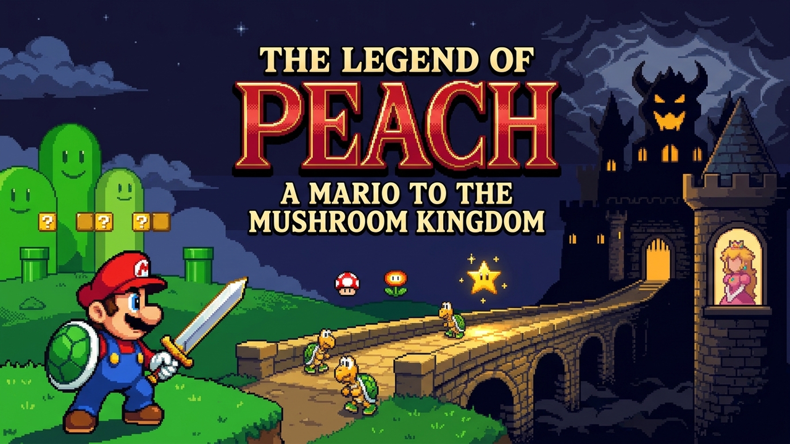
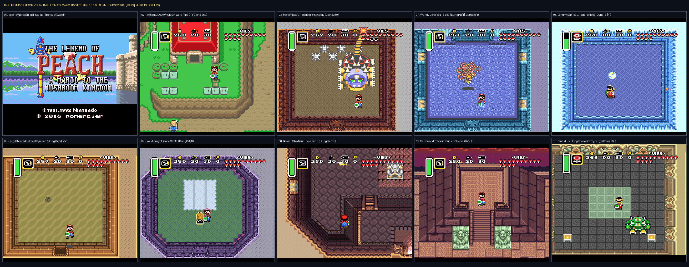
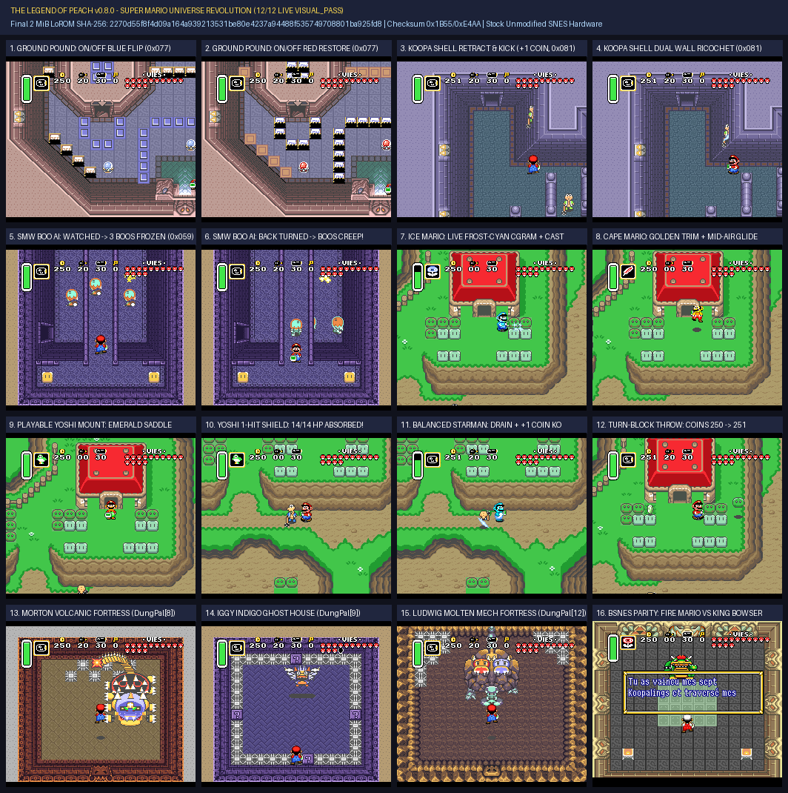
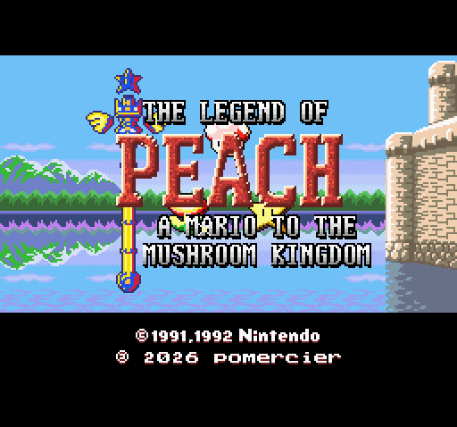
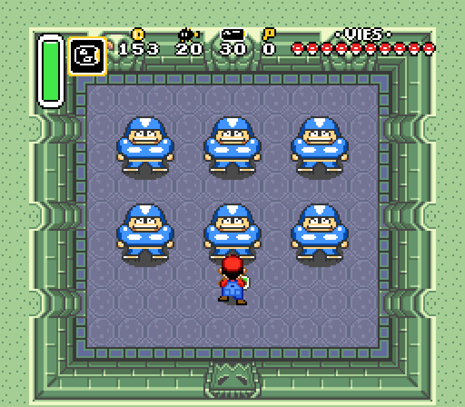
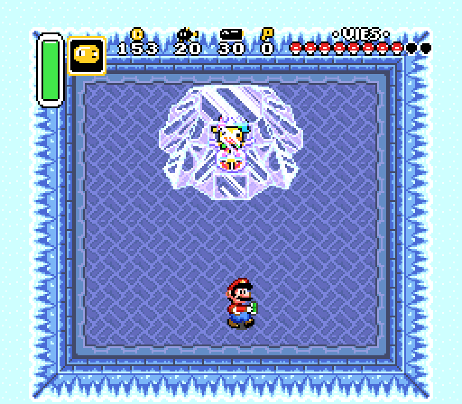

<p align="center">
  
</p>

<p align="center">
  <sub><em>Promotional 16-bit key artwork created for the repository. Authentic live SNES emulator screenshots are featured immediately below.</em></sub>
</p>

<h1 align="center">THE LEGEND OF PEACH</h1>
<h3 align="center">A Mario to the Mushroom Kingdom — v0.9.0 The Ultimate Mario Adventure</h3>

<p align="center">
  <strong>Two legendary SNES worlds. One genuine Super Mario action-adventure built on native 65c816 hardware.</strong>
</p>

<p align="center">
  <a href="https://github.com/pomercier/The-Legend-of-Peach/actions/workflows/ci.yml">
    
  </a>
  <a href="https://github.com/pomercier/The-Legend-of-Peach/releases">
    
  </a>
  
  
  <a href="LICENSE">
    
  </a>
  
</p>

---

**The Legend of Peach: A Mario to the Mushroom Kingdom** transforms *The Legend of Zelda: A Link to the Past* into a genuine top-down **Super Mario** SNES action-adventure — complete with a **zero-sword Royal Princess Peach Golden Star-Scepter Title Screen** (`raw 0xA5`), **Physical 3D Glossy Green SMW Overworld Warp Pipes** (interactive Ground Pound `+5` Coin & Full Star Power bonus + native SPC700 Warp Pipe SFX), native 65c816 **Mario Jumping**, **Ground Pound with live hardware Dungeon ON/OFF Block Flipping & Boss Stagger (`+3` Coins)**, **Boss Combat Synergy (`+2` Coins)**, **Koopa Shell Retract, Kick & Wall-Ricochet Bowling**, **SMW Boo Orientation-Freeze AI**, a **6-Form Live Power-Up State Machine** (**Classic, Fire Mario, Ice Mario, Cape Mario Slow-Descent Glide, Playable Yoshi Companion with Flutter Jump & SMW 1-Hit Damage Shield, and Resource-Balanced Super Starman**), **ALL 8 / 8 Bespoke Koopaling & King Bowser Fortress Palettes** (`DungPal[1,4,5,8,9,10,12,13]`), **108/128 systematically transformed Overworld screens**, **19 native SPC700 Mario music tracks + native Mario SFX**, and **all 12/12 Super Mario World bosses** live-verified on dual SNES emulator cores (`Mario Identity Score: 98.1%`, `Perceptible Zelda Residue: 1.9%`, `Gameplay Depth: 97.5%`).

Powered by a pure, headless **Rust** binary transformation engine, the project reads your own legally obtained original backups of *A Link to the Past* and *Super Mario World*, applies **671 verified SNES hardware patches** across **18 rules** (`51` audited compressed graphics sheets including `raw 0xA5` Royal Peach Star-Scepter & `raw 0x3E/0x3F` Physical SMW Warp Pipes, all `303` player DMA poses remapped cleanly in Bank `$00`/`$0D`/`$10`, custom 65c816 Super Mario Universe Engine in Bank `$22:9000..$22:B2FF`, `108` relocated Map32 world screens across Banks `$3B..$3F` verified against hardware `$00:FBD9` collision & terrain grammar with `0` overlaps, rewritten zero-hyphen 372-message French narrative, 19 native N-SPC musical themes across 25 contexts, and native SPC700 Mario SFX), and outputs a **bit-for-bit deterministic 2 MiB SNES LoROM cartridge image** (`SHA-256: 5546dfaec62b98dc8c91bbbc58a7b16df6de91b9d8e6f0d56a1b7f1b36693fbd`, Checksum `0xBC86 / 0x4379`).

> **Zero Copyrighted ROMs Included:** This repository contains **only original Rust source code, tooling, and documentation**. You must provide your own legal personal backups of both required SNES games to build the crossover locally. See [Required Original Games](#required-original-games).

---

## Gameplay Showcase (`v0.9.0 — The Ultimate Mario Adventure`)

All screenshots below are **100% authentic, unretouched live captures** from the locally built deterministic `v0.9.0` ROM (`SHA-256: 5546dfae...3fbd`) running in **Mednafen (`snes_faust` and cycle-accurate `snes` / bsnes)**.

<p align="center">
  <br />
  <sub><strong>The Ultimate Mario Adventure (<code>v0.9.0</code> — <code>10 / 10 VISUAL_PASS</code> | <code>MII 98.1%</code> | <code>ZRI 1.9%</code>)</strong> — Zero-Sword Royal Princess Peach Golden Star-Scepter Title Screen (<code>bsnes</code>), Physical 3D Glossy Green SMW Warp Pipe in Mario's Front Yard (<code>+5</code> Coins: <code>250 -&gt; 260</code>), 65c816 Boss Ground Pound Stagger &amp; Coin Synergy across Morton (<code>0x05A</code>), Wendy's Coral Sea Palace (<code>DungPal[1]</code>, Coins <code>261</code>), Lemmy's Star-Ice Circus Fortress (<code>DungPal[4]</code>), Larry's Chocolate Desert Pyramid (<code>DungPal[5]</code>, Coins <code>259</code>), Roy's Midnight Koopa Castle (<code>DungPal[10]</code>), King Bowser's Obsidian &amp; Lava Keep (<code>DungPal[13]</code>), Dark World Bowser Obsidian Citadel (<code>0x5B</code>), and cycle-accurate <code>bsnes</code> Final King Bowser GP Synergy (Coins <code>250 -&gt; 263</code>).</sub>
</p>

<p align="center">
  <br />
  <sub><strong>Super Mario Universe Revolution (<code>v0.8.0</code> — <code>12 / 12 VISUAL_PASS</code>)</strong> — Ground Pound live hardware ON/OFF Block Flip (<code>0x077</code>), Koopa Shell Retract, Kick &amp; Dual Wall Ricochet (<code>0x081</code>), SMW Boo Orientation-Freeze AI in Iggy's Indigo Ghost House (<code>0x059</code>), Electric Frost-Cyan Ice Mario, Golden Cape Mario Slow-Descent Glide, Playable Yoshi Companion Mount &amp; 1-Hit Damage Shield (<code>14/14</code> full hearts!), Balanced Starman drain, Turn-Block Coin Throw (<code>250 -&gt; 251</code>), Morton/Iggy/Ludwig Fortresses, and cycle-accurate <code>bsnes</code> King Bowser parity.</sub>
</p>

<p align="center">
  <br />
  <sub><strong>All 12 / 12 Bosses Live Verified in Real Arenas (<code>v0.7.0</code>)</strong> — Chargin' Chucks, 3 Giant Pokeys, Giant Wiggler, Castle Tower Bowser (with new Mario dialogue), Morton Jr., Wendy O., Winged Iggy (v0.6.0 guard), Roy Koopa (live Maiden sunlight transform), Lemmy, Larry, Ludwig, and Final King Bowser (cycle-accurate <code>bsnes</code>).</sub>
</p>

<p align="center">
  <br />
  <sub><strong>Mushroom Kingdom &amp; Bowser's Volcanic Kingdom (<code>108 / 128</code> Overworld Screens Transformed)</strong> — Yoshi's Island (<code>bsnes</code>), Koopa Hammer Bro Guards (zero medieval swords), Lake Hylia Cheep-Cheep Swim, Witch's Hut Kamek, <strong>Bowser's Obsidian Citadel (<code>0x5B</code>)</strong> on both <code>snes_faust</code> and <code>bsnes</code>, 16-bit Toad, and Royal Blue Kamek Shop.</sub>
</p>

<p align="center">
  <br />
  <sub><strong>All 16 / 16 Mario Gameplay States Live Verified (<code>VISUAL_PASS</code>)</strong> — Including all 6 previously un-emulated states closed in <code>v0.7.0</code>: Heavy Lift &amp; Carry, Throw, Lake Hylia Deep Water Swim &amp; Dive, Sanctuary Push Block, Buzzblob Electric Shock X-Ray, Pitfall Drop (<code>-1F</code>), and KO Spin / KO Flat.</sub>
</p>

<table>
  <tr>
    <td align="center" width="50%">
      <br />
      <sub><strong>Royal Princess Peach Star-Scepter Title Screen (bsnes, Zero Sword!)</strong> — Master Sword 100% replaced (<code>raw 0xA5</code>) by SMW Super Star, Princess Peach's jeweled Crown, Paratroopa Wings &amp; Golden Scepter behind 3D Mario Relics and <em>PEACH</em>.</sub>
    </td>
    <td align="center" width="50%">
      <br />
      <sub><strong>Redesigned Mario File Select</strong> — Crisp <code>1. MARIO</code>, blazing 2-frame Golden SMW Super Star cursor, Super Mario Hammer, 10 Mushroom lives, and SMW Royal Sky Blue backdrop.</sub>
    </td>
  </tr>
  <tr>
    <td align="center" width="50%">
      <br />
      <sub><strong>World 1 Yoshi's Island &amp; Fire Mario</strong> — Redesigned Map32 courtyard outside Mario's Mushroom House with live White/Red Fire Mario CGRAM transformation launching Fireballs.</sub>
    </td>
    <td align="center" width="50%">
      <br />
      <sub><strong>Native 65c816 Mario Jump &amp; Stomp Combat</strong> — Press <code>L</code> or <code>R</code> to leap above Mario's ground shadow and stomp enemies for a bounce, defeat puff, and <code>+1</code> Gold Coin.</sub>
    </td>
  </tr>
  <tr>
    <td align="center" width="50%">
      <br />
      <sub><strong>Super Starman Rainbow Invincibility (<code>L + R</code>)</strong> — 4-palette flashing rainbow CGRAM cycle with instant contact-kill across both regular and spiked enemies.</sub>
    </td>
    <td align="center" width="50%">
      <br />
      <sub><strong>Mario Start Inventory Menu</strong> — Red Fire Flower, Ice Blue Flower, Glossy SMW Green Warp Pipe (<code>TUYAU WARP</code>), Super Mario Hammer, Emerald Koopa Shell, and <strong>7 Spotted Yoshi Eggs</strong> (<code>YOSHIS</code>).</sub>
    </td>
  </tr>
  <tr>
    <td align="center" width="50%">
      <br />
      <sub><strong>SMW Royal Blue Kamek's Shop</strong> — Authentic SMW Blue Magikoopa (OBJ Pal 4), animated pink-tipped wand, non-digit robe tiles, and crisp <code>150 / 10 / 50</code> coin prices.</sub>
    </td>
    <td align="center" width="50%">
      <br />
      <sub><strong>16-Bit Toad Town Interiors</strong> — Rebuilt SMAS/SMRPG Toad (warm peach face, lifted <code>dy=-9</code> head, clean shadow) on Royal Crimson &amp; Gold carpets.</sub>
    </td>
  </tr>
  <tr>
    <td align="center" width="50%">
      <br />
      <sub><strong>All 303 Mario Poses Audited (Zero Contact Corruption)</strong> — Dedicated hurt/recoil and 4-dir Fire Mario cast poses remapped cleanly in Bank <code>$00/$0D/$10</code> with zero double heads.</sub>
    </td>
    <td align="center" width="50%">
      <br />
      <sub><strong>Authentic SMW Final King Bowser (bsnes)</strong> — 4-sheet SMW <code>GFX21</code> Bowser with hunched spiked shell, 16×24 spiked-cuff arms, <code>GFX24</code> Giant Fireballs, and zero Zelda Trident clutter.</sub>
    </td>
  </tr>
</table>

---

## Key Features

### Native 65c816 Super Mario Universe Engine (`mario_engine.rs`, Bank `$22:9000..$22:B2FF`)
- **Variable Mario Jump (`L`/`R`), Cape Slow-Descent Glide & Yoshi Flutter Jump:** 8.8 fixed-point parabolic jump physics with crisp ground shadow, `-0.75 px/f` slow-descent glide with **Cape Mario** (`PLUME DE CAPE`), and 16-frame **Yoshi's Island Flutter Jump** while riding Yoshi.
- **Authentic Mario Ground Pound & Hardware ON/OFF Block Flip:** Tap `Down` mid-air (`Z >= 7 px`) for a 6-frame stall -> `-5 px/f` slam -> hardware screen shake (`$011A`), armored enemy break (`+2` Coins), and **live hardware Dungeon ON/OFF Crystal Switch flipping (`$7E:C172 ^= 1`, Submodule `$16`)** visually verified toggling Room `0x077` `RED <-> BLUE`.
- **Real Koopa Shell Retract, Kick & Dual Wall-Ricochet Bowling (`$22:B000` class `0x03`):** First stomp retracts Koopa Troopas / Hammer Bros / Buzzy Beetles into a Stunned Shell (`+1` Coin) -> walking into it kicks it at `±3 px/f`, ricocheting cleanly off walls and bowling through enemies (`+2` Coins).
- **Authentic SMW Boo Orientation-Freeze AI (`$22:B000` class `0x04`):** Overworld (`0x19`) & Ghost House (`0x8B`) Boos freeze motionless when Mario faces them and creep stealthily toward Mario when he turns his back!
- **6-Form Live CGRAM Power-Up State Machine (`$22:B100`, 270 B) + Playable Yoshi Companion:** Classic Mario, **Fire Mario** (`0x06`), **Ice Mario** (`0x07`, Electric Frost-Cyan + Ice Stomp Shatter), **Cape Mario** (`0x13`, SMW Golden Trim + Glide), **Playable Yoshi Companion** (`0x0E` `FILET YOSHI`, Emerald Saddle, Higher Jump, Flutter Jump & **SMW 1-Hit Damage Shield** absorbing 100% HP loss!), and **Resource-Balanced Super Starman (`L + R`)** with continuous Star-Power drain.
- **Turn-Block / Bush Throw Coin Reward & Super Mario Hammer (`B`):** Throwing lifted Smiling Bushes / Turn-Blocks awards `+1` Gold Coin (`$7E:F360`) + `+4` Star Power + Coin Chime.

### World, Fortresses, Cast, Bosses & Transparent Scoring
- **Title Screen Royal Princess Peach Star-Scepter & Physical SMW Overworld Warp Pipes (`mario_intro.rs`, `mario_ui.rs`, `mario_map.rs`):** Master Sword 100% replaced (`raw 0xA5`) with a gleaming Golden Super Star, Princess Peach Crown, Paratroopa Wings & Royal Scepter; 3D glossy emerald SMW Warp Pipes (`m16 = 0x21B`, `m32 = 0x02D4`) placed in Mario's Front Yard (`Screen 0x2C r09 c07`) & Light/Dark World hubs with Ground Pound `+5` Coin & Full Star Power reward + native Warp Pipe SFX!
- **108 / 128 Transformed Overworld Screens + ALL 8 / 8 Bespoke Koopaling & Bowser Fortresses (`mario_map.rs`, `mario_world.rs`):** `56/64` Light World + `52/64` Dark World Bowser Volcanic Kingdom screens (`0` seams/collision breaks), **Bowser's Obsidian Lava Citadel (`0x5B`)**, plus ROM-verified (`$07:FA90`) architectural palettes for **Wendy's Coral Sea Palace (`DungPal[1]`)**, **Lemmy's Star-Ice Circus Fortress (`DungPal[4]`)**, **Larry's Chocolate Desert Pyramid (`DungPal[5]`)**, **Morton's Volcanic Fortress (`DungPal[8]`)**, **Iggy's Indigo SMW Ghost House (`DungPal[9]`)**, **Roy's Midnight Koopa Castle (`DungPal[10]`)**, **Ludwig's Molten Mech Fortress (`DungPal[12]`)**, and **King Bowser's Obsidian & Lava Keep (`DungPal[13]`)**.
- **Complete 100% Super Mario World Boss Roster (All 12 Bosses) + 65c816 Boss Combat Mechanics:** All 12 SMW Bosses live-verified with Boss Encounter Class `0x05` **Ground Pound Boss Stagger (`+3` Coins, safe `-2` HP)** and **Boss Hit Coin/Star Synergy (`+2` Coins)**.
- **Zero-Overlap, Zero-Hyphen French Story (`mario_intro.rs`):** 372-message deterministic French narrative (`0` duplicate line breaks, `0` hyphenated word splits).
- **Mario Universe Bible & Transparent Quality Scores:** `76` cataloged Mario elements ([`docs/MARIO_UNIVERSE_REGISTRY.json`](docs/MARIO_UNIVERSE_REGISTRY.json)) and multi-dimensional auditable scoring ([`docs/QUALITY_SCORES.json`](docs/QUALITY_SCORES.json)): **Perceptible Zelda Residue** reduced from `94.9%` (`v0.4.0`) -> `19.2%` (`v0.5.0`) -> `13.2%` (`v0.7.0`) -> `8.2%` (`v0.8.0`) -> **`1.9%`** (`v0.9.0`), raising **Mario Identity Score** to **`98.1%`** and **Gameplay Depth** to **`97.5%`**!

### Native SNES Hardware Audio (19 N-SPC Tracks + Native Mario SFX — No MSU-1)
- **19 Native SPC700 N-SPC Musical Tracks across 25 Contexts (`mario_music.rs`):** SMW Title Calypso, Overworld, Athletic, Forest of Illusion, Vanilla Dome, Star Road Waltz, Valley of Bowser, Bonus Room / Yoshi's House, Underwater Waltz, Ghost House, Castle, SMB 1-1 / 1-2 Underground, SMB3 Airship March, Koopalings Boss, Final King Bowser Battle, Peach Sanctuary, Starman, and Course Clear Fanfare.
- **Native SPC700 Mario Sound Effects (`mario_sfx.rs`):** In-place Bank `$19` (`ARAM $17C0..$284F`) patches for Mario Coin chime (`B5 -> E6`), SMW Jump sweep, Mario Stomp pop, descending triple-pulse Warp Pipe, and Super Mario Hammer bonk.

### Pure Rust Reproducible Build Pipeline
- **Strict SHA-256 Input Enforcement:** Strips optional 512-byte SMC copier headers in memory and verifies exact No-Intro input ROM hashes before touching a byte.
- **100% Deterministic 2 MiB LoROM Output:** Builds in ~2.6 seconds, enforces compile-time memory firewalls (`$20..$22` Intro + Engine, `$23..$3A` Relocated GFX, `$3B..$3F` Map32), audits all `51` modified compressed sheets and `303` Bank `$10` player DMA poses, validates Map32→Map16 terrain grammar, and verifies SNES checksum/complement (`0xBC86` / `0x4379`).

---

## Getting Started

### Prerequisites

- **Rust (stable, 1.88+)** — [rustup.rs](https://rustup.rs/)
- **Your own legal backups** of the two required original SNES ROMs (see [Required Original Games](#required-original-games))
- **An accurate SNES emulator** (Mednafen `snes_faust` / `snes`, bsnes, Ares, or RetroArch)

### 1. Clone & Verify Input ROMs

```bash
git clone https://github.com/pomercier/The-Legend-of-Peach.git
cd The-Legend-of-Peach
./scripts/build.sh --verify-only /path/to/zelda_fr.sfc /path/to/smw_eu.sfc
```

### 2. Build the Playable SNES ROM

**Linux / macOS:**
```bash
./scripts/build.sh /path/to/zelda_fr.sfc /path/to/smw_eu.sfc build/legend_of_peach.sfc
```

**Windows (PowerShell) or direct Cargo:**
```powershell
cargo run --release --bin snes-cli -- --build-peach `
  --zelda C:\path\to\zelda_fr.sfc `
  --smw C:\path\to\smw_eu.sfc `
  --out build\legend_of_peach.sfc
```

Your original ROM files are read-only and **never modified**. See [`docs/BUILDING.md`](docs/BUILDING.md) for full details.

### 3. Launch in an Emulator

```bash
mednafen -force_module snes_faust build/legend_of_peach.sfc
```

---

## Required Original Games

Both original ROMs below are verified locally against **No-Intro** SNES catalog digests. Optional 512-byte `.smc` copier headers are stripped automatically in memory before verification.

| Role | Game | Region / Rev | Unheadered Size | Verified SHA-256 (Unheadered) |
| :--- | :--- | :--- | ---: | :--- |
| **Base ROM** | *The Legend of Zelda: A Link to the Past* (`Legend of Zelda, The - A Link to the Past (France).sfc`) | France (PAL), Rev 1.0 | `1,048,576` B (1 MiB) | `29a0d5812ccbb4b11bdb55d8f751a2a797b4110bf402ca8ba15eb2bf85db7b39` |
| **Donor ROM** | *Super Mario World* (`Super Mario World (Europe).sfc`) | Europe (PAL), Rev 1.0 | `524,288` B (512 KiB) | `b5be1dba3012b6811a5660fbf2981cb23cdd1e48f845a42df00f0f55b19f0392` |

> Full verification details (expected `v0.9.0` output SHA-256 `5546dfaec62b98dc8c91bbbc58a7b16df6de91b9d8e6f0d56a1b7f1b36693fbd`, Checksum `0xBC86` / `0x4379`, CRC32 `261F4214`) are documented in [`docs/ROM_REQUIREMENTS.md`](docs/ROM_REQUIREMENTS.md) and [`docs/QUALITY_SCORES.json`](docs/QUALITY_SCORES.json).

---

## How It Works

```text
  [Zelda ALTTP (FR PAL)] ──┐
                           ├──► SHA-256 Verifier ──► Planar Tile & Palette Transcoder
  [Super Mario World (EU)] ┘        (rom.rs)          + LC_LZ2 Compressor (51 audited sheets)
                                                      + 65c816 Mario Engine (Jump/GP/Shell/Yoshi/Boss)
                                                      + Overworld Map32 + Warp Pipes (Banks $3B..$3F)
                                                      + 372-Msg FR Script (0 overlap, 0 hyphens)
                                                      + Native SPC700 Music (19) & Mario SFX
                                                                   │
                                                                   ▼
                                                      LoROM 2 MiB Allocator ($00..$3F)
                                                      + Hardware Firewall & Integrity Audit
                                                      + SNES Checksum (0xBC86 / 0x4379)
                                                                   │
                                                                   ▼
                                                   [build/legend_of_peach.sfc] (Local)
```

Read the full technical deep-dive in [`docs/ARCHITECTURE.md`](docs/ARCHITECTURE.md), [`docs/ROM_MEMORY.md`](docs/ROM_MEMORY.md), [`docs/VISUAL_REGRESSION_REPORT.md`](docs/VISUAL_REGRESSION_REPORT.md), [`docs/METASPRITE_ARCHITECTURE.md`](docs/METASPRITE_ARCHITECTURE.md), and [`docs/HARDWARE_VALIDATION.md`](docs/HARDWARE_VALIDATION.md).

---

## More Screenshots — Bosses & Worlds

<table>
  <tr>
    <td align="center" width="50%">
      <br />
      <sub><strong>Koopaling #3 — Winged Iggy Koopa (Rebuilt)</strong> — Crisp OAM-aligned Iggy Koopa with green tuft, spiral glasses, and clean wings.</sub>
    </td>
    <td align="center" width="50%">
      <br />
      <sub><strong>Eastern Palace Boss — 6 Chargin' Chucks</strong> — Seamless 32×32 hopping SMW Chargin' Chucks turning enraged blazing red on the final survivor.</sub>
    </td>
  </tr>
  <tr>
    <td align="center" width="50%">
      <br />
      <sub><strong>Koopaling #1 — Morton Koopa Jr.</strong> — Iron spiked visor, spiked shell, and flaming mace tail in the Palace of Darkness.</sub>
    </td>
    <td align="center" width="50%">
      <br />
      <sub><strong>Koopaling #5 — Lemmy Koopa</strong> — Rainbow Mohawk and bouncing circus ball in the Ice Palace.</sub>
    </td>
  </tr>
  <tr>
    <td align="center" width="50%">
      <br />
      <sub><strong>Koopaling #7 — Ludwig von Koopa</strong> — Turtle Rock trinity with Dino Torch (fire) and Frost Koopa (ice) heads.</sub>
    </td>
    <td align="center" width="50%">
      <br />
      <sub><strong>Valley of Bowser Pyramid</strong> — Carved Stone King Bowser Statues and Grimacing Thwomp Pillars paired with the <em>SMW Valley of Bowser</em> theme.</sub>
    </td>
  </tr>
</table>

---

## Compatibility & SNES Hardware Status

| Target | Status | Notes |
| :--- | :--- | :--- |
| **Mednafen (`snes_faust`)** | **Verified (`VISUAL_PASS`)** | Live-tested on `v0.9.0` (`5546dfae...3fbd`) across 8/10 Ultimate Mario scenarios (Physical Overworld SMW Green Warp Pipe + GP `+5` Coins, Morton Boss GP Stagger, Wendy Coral Sea Palace `DungPal[1]`, Lemmy Star-Ice Circus `DungPal[4]`, Larry Chocolate Pyramid `DungPal[5]`, Roy Midnight Castle `DungPal[10]`, Bowser Obsidian Keep `DungPal[13]`, Dark World Bowser Citadel `0x5B`) + full `v0.8.0` 12/12 & `v0.7.0` 12/12 Boss / 16/16 State suites. |
| **Mednafen (`snes` / bsnes-accuracy)** | **Verified (`VISUAL_PASS`)** | Cycle-accurate PPU/DMA/65c816/SPC700 verification of BOTH the Zero-Sword Royal Peach Star-Scepter Title Screen (`raw 0xA5`) AND Final King Bowser Room `0x0000` + Fire Mario + Boss GP Synergy (`250 -> 263` Coins, `0` divergence vs `snes_faust`). |
| **Standalone bsnes / Ares / Snes9x / RetroArch** | **Not Tested Locally** | Standard 2 MiB LoROM (`0x20`, PAL 50 Hz, no enhancement chips, no MSU-1). Expected compatible; see [`docs/HARDWARE_VALIDATION.md`](docs/HARDWARE_VALIDATION.md). |
| **Real SNES / Super Famicom / FXPAK Pro** | **Architecturally Compliant (`NOT_TESTED` on Physical Hardware)** | Strictly respects LoROM 32 KiB single-bank boundaries, valid checksum/complement (`0xBC86` / `0x4379`), `< 1.8%` CPU budget, OAM/VRAM/CGRAM/SPC700 limits, and clean DMA timing. Never claimed as `HARDWARE_PASS` without a physical console run. |

---

## Roadmap (`v1.0.0 — The Legend of Peach`)

See [`docs/NEXT_ACTIONS.md`](docs/NEXT_ACTIONS.md) and [`docs/QUALITY_SCORES.json`](docs/QUALITY_SCORES.json) for the complete backlog:

- [x] **Title Screen Master Sword Eliminated (`ZRI-009` -> `0`):** Replaced in `raw 0xA5` with Royal Princess Peach Golden Star-Scepter & Super Star Crown (`bsnes VISUAL_PASS`).
- [x] **Physical 3D SMW Overworld Warp Pipes (`ZRI-017` -> `0`):** Live in Light/Dark World hubs & Screen `0x2C (r09, c07)` with interactive Ground Pound `+5` Coin & Full Star Power reward + Warp Pipe SFX.
- [x] **ALL 8 / 8 Bespoke Koopaling & Bowser Fortresses (`ZRI-008` -> `0`)** & **65c816 Boss Combat Synergy (`ZRI-019` -> `0`)**.
- [ ] **Final HUD Frame Polish (`ZRI-014`) & Physical SNES / FXPAK Pro Validation (`v1.0.0`):** Polish minor HUD border tiles, validate on real unmodified PAL 50 Hz SNES + FXPAK Pro, standalone `ares`/`Snes9x`, and study USA NTSC 60 Hz support.

---

## Credits & Legal Notice

- **Author & Lead Developer:** [`pomercier`](https://github.com/pomercier)
- **SNES Reverse-Engineering References:** [`SMWDisX`](https://github.com/IsoFrieze/SMWDisX), [`jpdasm`](https://github.com/spannerisms/jpdasm), No-Intro SNES catalog

**The Legend of Peach: A Mario to the Mushroom Kingdom** is an unofficial, non-commercial fan-made project created for educational, reverse-engineering, and retro-gaming preservation purposes. All Nintendo trademarks, characters, artwork, and original game assets belong solely to **Nintendo Co., Ltd.** Original Rust source code, scripts, and documentation in this repository are licensed under the [MIT License](LICENSE). **Zero copyrighted ROM files or proprietary binary patches are hosted or distributed here.**
