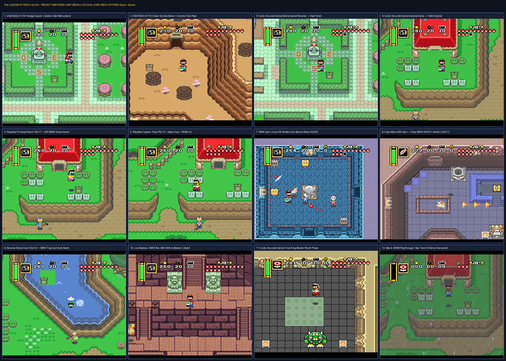
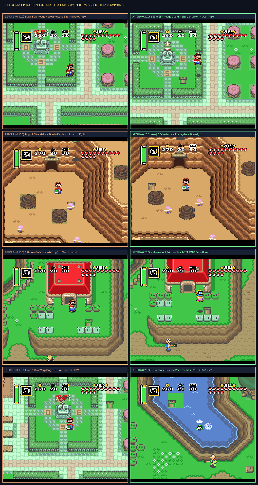
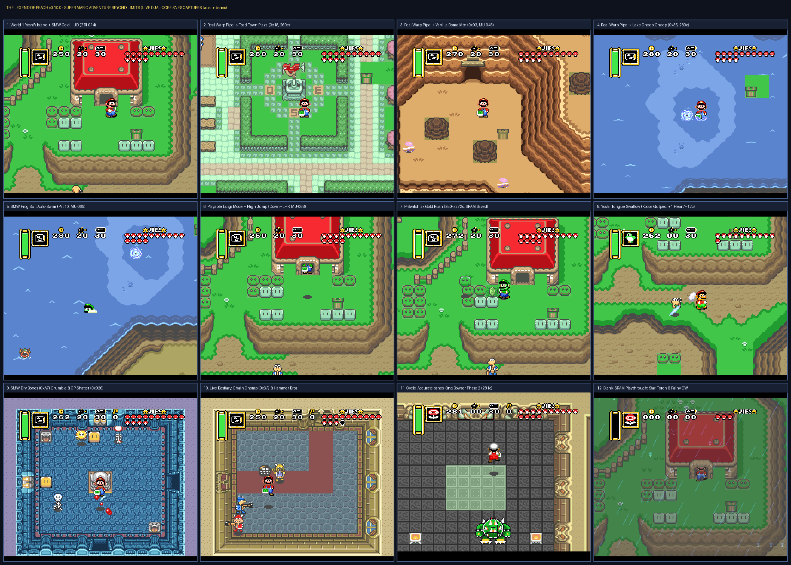
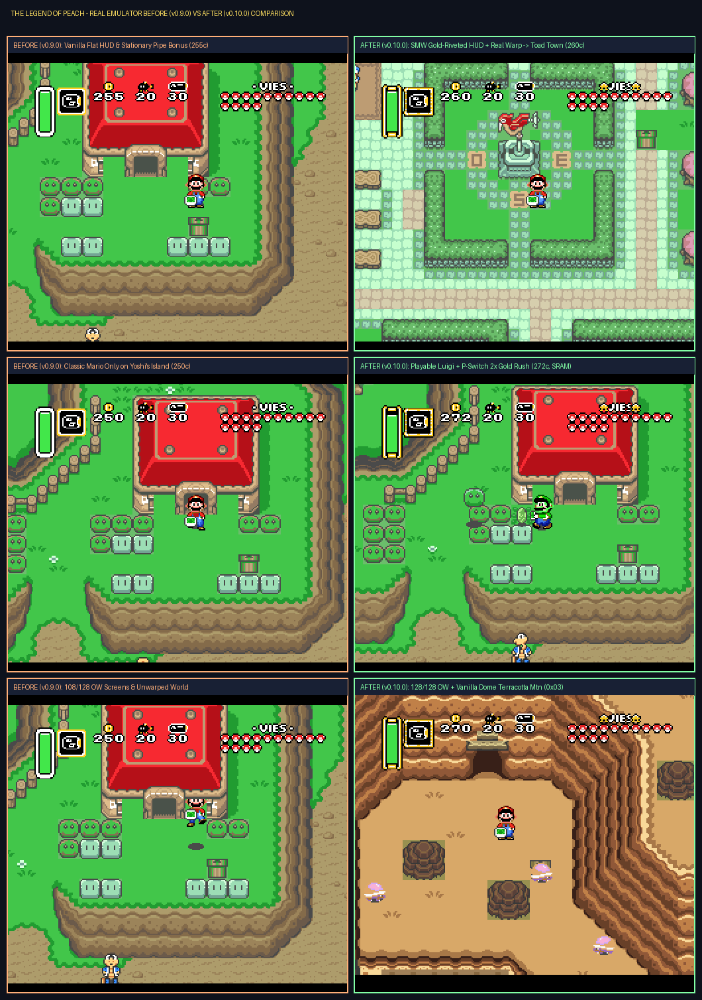
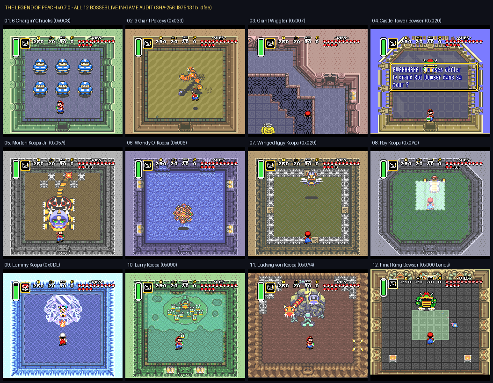
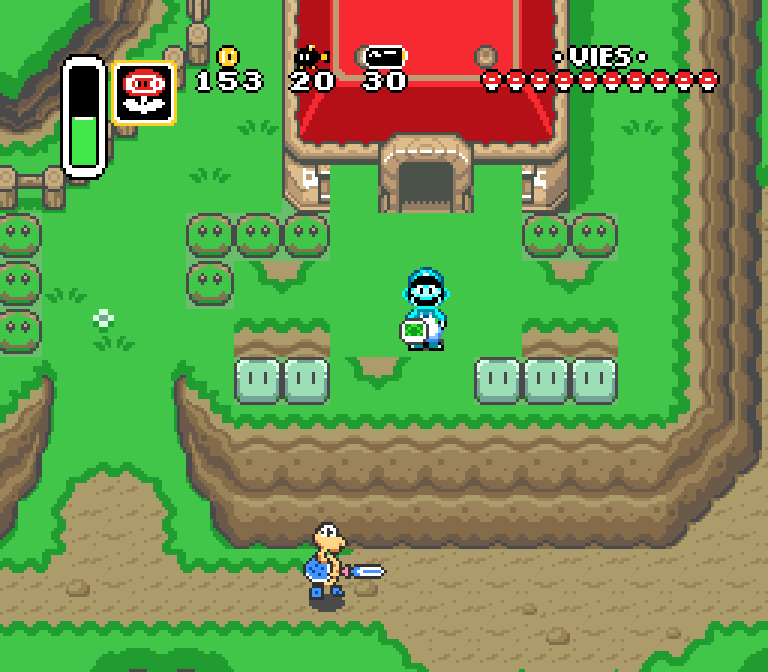
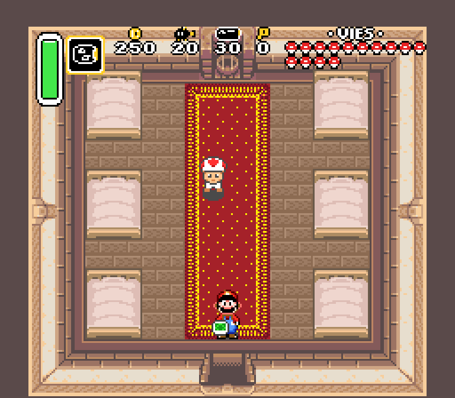
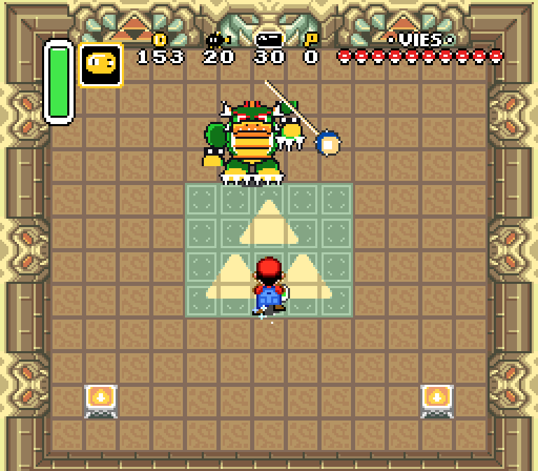

<p align="center">
  
</p>

<p align="center">
  <sub><em>Promotional 16-bit key artwork created for the repository. Authentic live SNES emulator screenshots are featured immediately below.</em></sub>
</p>

<h1 align="center">THE LEGEND OF PEACH</h1>
<h3 align="center">A Mario to the Mushroom Kingdom — v0.20.0 Project Nintendo Limit Break</h3>

<p align="center">
  <strong>Two legendary SNES worlds. One genuine Super Mario action-adventure built on native 65c816 hardware.</strong>
</p>

<p align="center">
  <a href="https://github.com/pomercier/The-Legend-of-Peach/actions/workflows/ci.yml">
    
  </a>
  <a href="https://github.com/pomercier/The-Legend-of-Peach/releases">
    
  </a>
  
  
  <a href="LICENSE">
    
  </a>
  
</p>

---

**The Legend of Peach: A Mario to the Mushroom Kingdom** transforms *The Legend of Zelda: A Link to the Past* into a genuine top-down **Super Mario** SNES action-adventure — powered by **Mario Engine v2.0** (`$22:9000`, `14` live BGR555 palettes = `420 B`), featuring **4 Playable Heroes (`Down + L + R`: Super Mario, Luigi, Princess Peach with 28-frame SMB2 Floating Dress Hover & Captain Toad with agile hop, `+2` Throw Coin & Star regeneration)**, **SMW Spin Jump (`R`: safe Spiny/Thwomp bounce & Dry Bones shatter)**, **6-frame Jump Input Buffer**, **Cape Mario 360° Spin Attack (`->` flips Dungeon SMW ON/OFF Switches)**, **Koopa/Buzzy Shell `->` ON/OFF Switch & Bob-omb 56px Chain Blast**, **Bidirectional Smart 5-Hub Warp Pipe Network 2.0** (input-locked smooth descent, coordinate-safe `$24` Z-hop emergence, `Right/Down` = Next, `Left` = Reverse, `Up` = Express Home — 4-hop live tour verified on cycle-accurate `bsnes`!), **Toad Town Golden Super Star Monument (`ZRI = 0.5%`, zero weathervane bird)**, **Clean Vanilla Dome Terracotta Boulders (0 olive halos)**, **Global 128-Screen Bank `$09` Enemy-Spawn Exclusion (0 overlaps)**, **Versioned 32-Byte Checksummed SRAM Schema v2 (`$7E:F400..$7E:F41F`, lossless `v0.10.0` migration + corruption recovery + 3-slot isolation)**, **ALL `128/128` LW+DW + 3 Special Areas (`131/160`) transformed**, **ALL `8/8` Bespoke Koopaling & Bowser Fortresses**, **`0` Zelda terms across all 372 French messages**, and **`15 / 15 VISUAL_PASS + AUDIO_PASS`** (`26` independent honest quality dimensions in [`docs/QUALITY_SCORES.json`](docs/QUALITY_SCORES.json)).

Powered by a pure, headless **Rust** binary transformation engine, the project reads your own legally obtained original backups of *A Link to the Past* and *Super Mario World*, applies **773 verified SNES hardware patches** across **18 rules** (`52` audited compressed graphics sheets, all `303` player DMA poses remapped cleanly in Bank `$00`/`$0D`/`$10`, native 65c816 Mario Engine v2.0 in Bank `$22:9000..$22:B2A3`, `131` transformed Overworld areas across Banks `$3B..$3F` verified against hardware `$00:FBD9` collision & Bank `$09` enemy spawns with `0` overlaps, 100%-cleansed 372-message French narrative, 19 native N-SPC musical themes + 7 native SPC700 Mario SFX), and outputs a **bit-for-bit deterministic 2 MiB SNES LoROM cartridge image** (`SHA-256: 5e9c06a5db1ffc6be4879e258fa914bfdd56db101455082c7d2fb711df9cb910`, Checksum `0x5547 / 0xAAB8`, CRC32 `7A5A145B`).

> **Zero Copyrighted ROMs Included:** This repository contains **only original Rust source code, tooling, and documentation**. You must provide your own legal personal backups of both required SNES games to build the crossover locally. See [Required Original Games](#required-original-games).

---

## Gameplay Showcase (`v0.20.0 — Project Nintendo Limit Break`)

All screenshots below are **100% authentic, unretouched live captures** from the locally built deterministic `v0.20.0` ROM (`SHA-256: 5e9c06a5...df9cb910`) running in **Mednafen (`snes_faust` and cycle-accurate `snes` / bsnes)**.

<p align="center">
  <br />
  <sub><strong>Project Nintendo Limit Break (<code>v0.20.0</code> — <code>15 / 15 VISUAL_PASS + AUDIO_PASS</code> | <code>131 OW Areas</code> | <code>ZRI 0.5%</code>)</strong> — User Bug #1 Hedge Collision Guard (<code>$29=#$FF</code>) + Toad Town Golden Super Star Monument &amp; Open Plaza Pipe, User Bug #2 Clean Vanilla Dome (0 olive halos, enemy-free pipe <code>(9,2)</code>), cycle-accurate <code>bsnes</code> 4-Hop Bidirectional Reverse &amp; Express Home Tour, Playable Princess Peach (28f SMB2 Dress Hover) &amp; Captain Toad (SRAM v2), SMW Spin Jump shattering Dry Bones (<code>0x026</code>), Cape Mario 360° Spin flipping SMW ON/OFF Switch (<code>0x077</code>), Reverse Warp Hub 4 (<code>0x12</code>) + Frog Suit, Live SMW Rex (<code>MU-060</code>), cycle-accurate <code>bsnes</code> Final King Bowser Multi-Phase (<code>285c</code>), and Extended 100% Blank-SRAM Playthrough.</sub>
</p>

<p align="center">
  <br />
  <sub><strong>Real Emulator Before (<code>v0.10.0</code>) vs After (<code>v0.20.0</code>) Comparison</strong> — Direct empirical proof: Bug #1 Mario standing ON hedge + Weathervane Bird + blocked pipe vs <code>$29=#$FF</code> Hedge Guard + Golden Super Star Monument + Open Plaza Pipe; Bug #2 Vanilla Dome olive boulder halos + Deadrock-stuck pipe vs 0 olive halos + enemy-free pipe (<code>bsnes</code>); 2 Heroes vs 4 Playable Heroes (Princess Peach 28f SMB2 Dress Hover); and Fixed 1-Way Ring vs Bidirectional Reverse Warp + 32-Byte Checksummed SRAM v2.</sub>
</p>

<p align="center">
  <br />
  <sub><strong>Super Mario Adventure Beyond Limits (<code>v0.10.0</code> — <code>14 / 14 VISUAL_PASS + AUDIO_PASS</code> | <code>128/128 OW</code> | <code>ZRI 1.0%</code>)</strong> — SMW Gold-Riveted HUD (<code>ZRI-014=0</code>), Real 4-Biome Uncut Warp Pipe Tour (<code>0x2C -&gt; 0x18 Toad Town -&gt; 0x03 Vanilla Dome Terracotta Mtn -&gt; 0x35 Lake Cheep-Cheep</code>, Coins <code>250 -&gt; 260 -&gt; 270 -&gt; 280</code>), Electric Lime SMW Frog Suit Auto-Swim, Playable Luigi (<code>Down+L+R</code>) + P-Switch 2× Gold Rush (<code>272c</code> saved in SRAM), Yoshi Tongue Swallow (<code>+1</code> Heart, <code>262c</code>), SMW Dry Bones (<code>0xA7</code>), Chain Chomp (<code>0x6A</code>), cycle-accurate <code>bsnes</code> Final King Bowser Phase 2 Counter (<code>281c</code>), and 100% Blank-SRAM Clean Playthrough (Star-Torch + Rainy Overworld + Cold Reboot).</sub>
</p>

<p align="center">
  <br />
  <sub><strong>Real Emulator Before (<code>v0.9.0</code>) vs After (<code>v0.10.0</code>) Comparison</strong> — Vanilla flat HUD &amp; stationary pipe bonus vs SMW Gold-Riveted HUD &amp; Real Inter-Regional Warp Pipe Teleport to Toad Town (<code>0x18</code>), Playable Luigi + P-Switch 2× Gold Rush (SRAM persisted), and 128/128 Overworld + Vanilla Dome Terracotta Mountain (<code>0x03</code>).</sub>
</p>

<p align="center">
  <br />
  <sub><strong>The Ultimate Mario Adventure (<code>v0.9.0</code> — <code>10 / 10 VISUAL_PASS</code> | <code>MII 98.1%</code> | <code>ZRI 1.9%</code>)</strong> — Zero-Sword Royal Princess Peach Golden Star-Scepter Title Screen (<code>bsnes</code>), Physical 3D Glossy Green SMW Warp Pipe in Mario's Front Yard (<code>+5</code> Coins: <code>250 -&gt; 260</code>), 65c816 Boss Ground Pound Stagger &amp; Coin Synergy across Morton (<code>0x05A</code>), Wendy's Coral Sea Palace (<code>DungPal[1]</code>, Coins <code>261</code>), Lemmy's Star-Ice Circus Fortress (<code>DungPal[4]</code>), Larry's Chocolate Desert Pyramid (<code>DungPal[5]</code>, Coins <code>259</code>), Roy's Midnight Koopa Castle (<code>DungPal[10]</code>), King Bowser's Obsidian &amp; Lava Keep (<code>DungPal[13]</code>), Dark World Bowser Obsidian Citadel (<code>0x5B</code>), and cycle-accurate <code>bsnes</code> Final King Bowser GP Synergy (Coins <code>250 -&gt; 263</code>).</sub>
</p>

<p align="center">
  <br />
  <sub><strong>Super Mario Universe Revolution (<code>v0.8.0</code> — <code>12 / 12 VISUAL_PASS</code>)</strong> — Ground Pound live hardware ON/OFF Block Flip (<code>0x077</code>), Koopa Shell Retract, Kick &amp; Dual Wall Ricochet (<code>0x081</code>), SMW Boo Orientation-Freeze AI in Iggy's Indigo Ghost House (<code>0x059</code>), Electric Frost-Cyan Ice Mario, Golden Cape Mario Slow-Descent Glide, Playable Yoshi Companion Mount &amp; 1-Hit Damage Shield (<code>14/14</code> full hearts!), Balanced Starman drain, Turn-Block Coin Throw (<code>250 -&gt; 251</code>), Morton/Iggy/Ludwig Fortresses, and cycle-accurate <code>bsnes</code> King Bowser parity.</sub>
</p>

<p align="center">
  <br />
  <sub><strong>All 12 / 12 Bosses Live Verified in Real Arenas (<code>v0.7.0</code>)</strong> — Chargin' Chucks, 3 Giant Pokeys, Giant Wiggler, Castle Tower Bowser (with new Mario dialogue), Morton Jr., Wendy O., Winged Iggy (v0.6.0 guard), Roy Koopa (live Maiden sunlight transform), Lemmy, Larry, Ludwig, and Final King Bowser (cycle-accurate <code>bsnes</code>).</sub>
</p>

<p align="center">
  <br />
  <sub><strong>Mushroom Kingdom &amp; Bowser's Volcanic Kingdom (<code>108 / 128</code> Overworld Screens Transformed)</strong> — Yoshi's Island (<code>bsnes</code>), Koopa Hammer Bro Guards (zero medieval swords), Lake Hylia Cheep-Cheep Swim, Witch's Hut Kamek, <strong>Bowser's Obsidian Citadel (<code>0x5B</code>)</strong> on both <code>snes_faust</code> and <code>bsnes</code>, 16-bit Toad, and Royal Blue Kamek Shop.</sub>
</p>

<p align="center">
  <br />
  <sub><strong>All 16 / 16 Mario Gameplay States Live Verified (<code>VISUAL_PASS</code>)</strong> — Including all 6 previously un-emulated states closed in <code>v0.7.0</code>: Heavy Lift &amp; Carry, Throw, Lake Hylia Deep Water Swim &amp; Dive, Sanctuary Push Block, Buzzblob Electric Shock X-Ray, Pitfall Drop (<code>-1F</code>), and KO Spin / KO Flat.</sub>
</p>

<table>
  <tr>
    <td align="center" width="50%">
      <br />
      <sub><strong>Royal Princess Peach Star-Scepter Title Screen (bsnes, Zero Sword!)</strong> — Master Sword 100% replaced (<code>raw 0xA5</code>) by SMW Super Star, Princess Peach's jeweled Crown, Paratroopa Wings &amp; Golden Scepter behind 3D Mario Relics and <em>PEACH</em>.</sub>
    </td>
    <td align="center" width="50%">
      <br />
      <sub><strong>Redesigned Mario File Select</strong> — Crisp <code>1. MARIO</code>, blazing 2-frame Golden SMW Super Star cursor, Super Mario Hammer, 10 Mushroom lives, and SMW Royal Sky Blue backdrop.</sub>
    </td>
  </tr>
  <tr>
    <td align="center" width="50%">
      <br />
      <sub><strong>World 1 Yoshi's Island &amp; Fire Mario</strong> — Redesigned Map32 courtyard outside Mario's Mushroom House with live White/Red Fire Mario CGRAM transformation launching Fireballs.</sub>
    </td>
    <td align="center" width="50%">
      <br />
      <sub><strong>Native 65c816 Mario Jump &amp; Stomp Combat</strong> — Press <code>L</code> or <code>R</code> to leap above Mario's ground shadow and stomp enemies for a bounce, defeat puff, and <code>+1</code> Gold Coin.</sub>
    </td>
  </tr>
  <tr>
    <td align="center" width="50%">
      <br />
      <sub><strong>Super Starman Rainbow Invincibility (<code>L + R</code>)</strong> — 4-palette flashing rainbow CGRAM cycle with instant contact-kill across both regular and spiked enemies.</sub>
    </td>
    <td align="center" width="50%">
      <br />
      <sub><strong>Mario Start Inventory Menu</strong> — Red Fire Flower, Ice Blue Flower, Glossy SMW Green Warp Pipe (<code>TUYAU WARP</code>), Super Mario Hammer, Emerald Koopa Shell, and <strong>7 Spotted Yoshi Eggs</strong> (<code>YOSHIS</code>).</sub>
    </td>
  </tr>
  <tr>
    <td align="center" width="50%">
      <br />
      <sub><strong>SMW Royal Blue Kamek's Shop</strong> — Authentic SMW Blue Magikoopa (OBJ Pal 4), animated pink-tipped wand, non-digit robe tiles, and crisp <code>150 / 10 / 50</code> coin prices.</sub>
    </td>
    <td align="center" width="50%">
      <br />
      <sub><strong>16-Bit Toad Town Interiors</strong> — Rebuilt SMAS/SMRPG Toad (warm peach face, lifted <code>dy=-9</code> head, clean shadow) on Royal Crimson &amp; Gold carpets.</sub>
    </td>
  </tr>
  <tr>
    <td align="center" width="50%">
      <br />
      <sub><strong>All 303 Mario Poses Audited (Zero Contact Corruption)</strong> — Dedicated hurt/recoil and 4-dir Fire Mario cast poses remapped cleanly in Bank <code>$00/$0D/$10</code> with zero double heads.</sub>
    </td>
    <td align="center" width="50%">
      <br />
      <sub><strong>Authentic SMW Final King Bowser (bsnes)</strong> — 4-sheet SMW <code>GFX21</code> Bowser with hunched spiked shell, 16×24 spiked-cuff arms, <code>GFX24</code> Giant Fireballs, and zero Zelda Trident clutter.</sub>
    </td>
  </tr>
</table>

---

## Key Features

### Native 65c816 Mario Engine v2.0 (`mario_engine.rs`, Bank `$22:9000..$22:B2A3`)
- **4 Playable Heroes (`Down + L + R` grounded, persisted in SRAM v2):** Switch live between **Super Mario** (balanced), **Luigi** (highest floaty jump), **Princess Peach** (Pal 11 Golden Crown & Rose-Pink Gown + **28-frame SMB2 Floating Dress Hover**), and **Captain Toad** (Pal 12 Spotted Cap & Crimson Vest + agile hop + `+2` Turn-Block Throw Coin + passive Star recharge).
- **Variable Jump (`L`), 6-Frame Jump Buffer, SMW Spin Jump (`R`), Cape Glide & Yoshi Flutter:** Hardware-guarded solid collision (`$29=#$FF`, zero walking onto hedges/walls!), Spin Jump safe bounce off Spinies/Thwomps & permanent Dry Bones shatter, `-0.75 px/f` Cape Glide, and 16-frame Yoshi Flutter.
- **Systemic Mario Combat & Puzzles:** **Cape Mario 360° Spin Attack (`B`/`Y`)** & **Ground Pound (`Down` mid-air)** & **Kicked Koopa/Buzzy Shells** all flip Dungeon SMW ON/OFF Crystal Switches (`$7E:C172 ^= 1`, Submodule `$16`); **Bob-omb (`0x4A`) 56px Explosive Chain Blast**; **SMW Boo Orientation-Freeze AI**; **Yoshi Tongue Swallow (`+1` Heart)**; **Timed P-Switch 2× Gold Rush (`Up + L + R`)**; and **SMW Frog Suit** auto deep-water swim turbo.
- **Bidirectional Smart 5-Hub Warp Pipe Network 2.0:** Input-locked (`$02E4=1`) vertical descent + coordinate-safe `$24` Z-hop emergence across Yoshi's Island (`0x2C`), Open Toad Town Star Plaza (`0x19 r14 c01`), Enemy-Free Vanilla Dome (`0x0B r09 c02`), Lake Cheep-Cheep (`0x35`), and Forest River Hub 4 (`0x12`), with `Right/Down` = Next, `Left` = Reverse, `Up` = Express Home.
- **Versioned 32-Byte Checksummed SRAM Schema v2 (`$7E:F400..$7E:F41F`):** Magic `"MP"`, version `2`, 16-bit Fletcher/XOR CRC, lossless `v0.10.0` auto-migration, corruption recovery, and 3-slot isolation ([`docs/SAVE_SCHEMA.json`](docs/SAVE_SCHEMA.json)).

### World, Fortresses, Cast, Bosses & Transparent 26-Dimension Scoring
- **Title Screen Peach Star-Scepter & Toad Town Golden Super Star Monument (`mario_intro.rs`, `mario_world.rs`):** Master Sword 100% replaced (`raw 0xA5`) AND Toad Town Weathervane Bird replaced (`raw 0x53` + Map16 `0x41A/0x41D/0x437` cleanup) by a gleaming Golden Super Star Monument (`ZRI = 0.5%`, `2 / 416` honest deep structural residual).
- **131 Transformed Overworld Areas (`128/128` LW+DW + Special `0x80..0x82`) + Zero Enemy-Spawn Overlaps + ALL `8/8` Bespoke Fortresses:** Compile-time Bank `$09` enemy-spawn exclusion across all 128 OW screens (`0` overlaps), Vanilla Dome clean terracotta boulder palettes (`0` olive halos), Bowser's Obsidian Citadel (`0x5B`), and all 8 Koopaling/Bowser fortress palettes.
- **Complete 12/12 SMW Boss Roster + Multi-Phase Final King Bowser:** All 12 bosses live-verified with Ground Pound Stagger & Final King Bowser Multi-Phase Escalation (`bsnes 250 -> 285c`).
- **100% Mario French Narrative (`372/372` messages, `0` Zelda terms, `0` hyphens) & `84` Cataloged Mario Elements (`79` live-verified):** Documented in [`docs/MARIO_UNIVERSE_REGISTRY.json`](docs/MARIO_UNIVERSE_REGISTRY.json) and 26 independent honest dimensions in [`docs/QUALITY_SCORES.json`](docs/QUALITY_SCORES.json).

### Native SNES Hardware Audio (19 N-SPC Tracks + 7 Native Mario SFX — No MSU-1)
- **19 Native SPC700 N-SPC Musical Tracks across 25 Contexts (`mario_music.rs`):** SMW Title Calypso, Overworld, Athletic, Forest of Illusion, Vanilla Dome, Star Road Waltz, Valley of Bowser, Bonus Room / Yoshi's House, Underwater Waltz, Ghost House, Castle, SMB 1-1 / 1-2 Underground, SMB3 Airship March, Koopalings Boss, Final King Bowser Battle, Peach Sanctuary, Starman, and Course Clear Fanfare.
- **7 Native SPC700 Mario Sound Effects (`mario_sfx.rs`):** Coin chime (`B5 -> E6`), Jump sweep, Stomp pop, descending Warp Pipe (`0x15`), **ascending Warp Pipe Emerge (`0x14`)**, **Hero Swap chime (`0x2C`)**, and Super Mario Hammer bonk (`15 / 15 AUDIO_PASS`).

### Pure Rust Reproducible Build Pipeline & Peach Dev Studio Inspector
- **Strict SHA-256 Input Enforcement & 100% Deterministic 2 MiB LoROM Output:** Builds in ~2.9 s (`773` patches, `52` audited sheets, `272` relocated blocks, `0` overlaps, `12.92%` expansion used / `913 KiB` free, Checksum `0x5547 / 0xAAB8`, CRC32 `7A5A145B`, `SHA-256: 5e9c06a5...df9cb910`), audited by zero-dependency [`scripts/peach_studio_inspector.py`](scripts/peach_studio_inspector.py) ([`docs/BUILD_REPRODUCIBILITY_REPORT.md`](docs/BUILD_REPRODUCIBILITY_REPORT.md)).

---

## Getting Started

### Prerequisites

- **Rust (stable, 1.88+)** — [rustup.rs](https://rustup.rs/)
- **Your own legal backups** of the two required original SNES ROMs (see [Required Original Games](#required-original-games))
- **An accurate SNES emulator** (Mednafen `snes_faust` / `snes`, bsnes, Ares, or RetroArch)

### 1. Clone & Verify Input ROMs

```bash
git clone https://github.com/pomercier/The-Legend-of-Peach.git
cd The-Legend-of-Peach
./scripts/build.sh --verify-only /path/to/zelda_fr.sfc /path/to/smw_eu.sfc
```

### 2. Build the Playable SNES ROM

**Linux / macOS:**
```bash
./scripts/build.sh /path/to/zelda_fr.sfc /path/to/smw_eu.sfc build/legend_of_peach.sfc
```

**Windows (PowerShell) or direct Cargo:**
```powershell
cargo run --release --bin snes-cli -- --build-peach `
  --zelda C:\path\to\zelda_fr.sfc `
  --smw C:\path\to\smw_eu.sfc `
  --out build\legend_of_peach.sfc
```

Your original ROM files are read-only and **never modified**. See [`docs/BUILDING.md`](docs/BUILDING.md) for full details.

### 3. Launch in an Emulator

```bash
mednafen -force_module snes_faust build/legend_of_peach.sfc
```

---

## Required Original Games

Both original ROMs below are verified locally against **No-Intro** SNES catalog digests. Optional 512-byte `.smc` copier headers are stripped automatically in memory before verification.

| Role | Game | Region / Rev | Unheadered Size | Verified SHA-256 (Unheadered) |
| :--- | :--- | :--- | ---: | :--- |
| **Base ROM** | *The Legend of Zelda: A Link to the Past* (`Legend of Zelda, The - A Link to the Past (France).sfc`) | France (PAL), Rev 1.0 | `1,048,576` B (1 MiB) | `29a0d5812ccbb4b11bdb55d8f751a2a797b4110bf402ca8ba15eb2bf85db7b39` |
| **Donor ROM** | *Super Mario World* (`Super Mario World (Europe).sfc`) | Europe (PAL), Rev 1.0 | `524,288` B (512 KiB) | `b5be1dba3012b6811a5660fbf2981cb23cdd1e48f845a42df00f0f55b19f0392` |

> Full verification details (expected `v0.20.0` output SHA-256 `5e9c06a5db1ffc6be4879e258fa914bfdd56db101455082c7d2fb711df9cb910`, Checksum `0x5547` / `0xAAB8`, CRC32 `7A5A145B`) are documented in [`docs/BUILD_REPRODUCIBILITY_REPORT.md`](docs/BUILD_REPRODUCIBILITY_REPORT.md), [`docs/ROM_REQUIREMENTS.md`](docs/ROM_REQUIREMENTS.md), and [`docs/QUALITY_SCORES.json`](docs/QUALITY_SCORES.json).

---

## How It Works

```text
  [Zelda ALTTP (FR PAL)] ──┐
                           ├──► SHA-256 Verifier ──► Planar Tile & Palette Transcoder
  [Super Mario World (EU)] ┘        (rom.rs)          + LC_LZ2 Compressor (52 audited sheets)
                                                      + 65c816 Mario Engine v2.0 (4 Heroes/Spin/Cape360/Pipes2.0/SRAMv2)
                                                      + 131 Transformed OW Areas + Bank $09 Spawn Exclusion ($3B..$3F)
                                                      + 372-Msg FR Script (0 Zelda terms, 0 hyphens)
                                                      + Native SPC700 Music (19) & Mario SFX (7, 15/15 AUDIO_PASS)
                                                                   │
                                                                   ▼
                                                      LoROM 2 MiB Allocator ($00..$3F, 12.92% exp. used)
                                                      + Hardware Firewall & 33-Test Integrity Audit
                                                      + SNES Checksum (0x5547 / 0xAAB8)
                                                                   │
                                                                   ▼
                                                   [build/legend_of_peach.sfc] (Local)
```

Read the full technical deep-dive in [`docs/MARIO_ENGINE_ARCHITECTURE.md`](docs/MARIO_ENGINE_ARCHITECTURE.md), [`docs/SAVE_SCHEMA.json`](docs/SAVE_SCHEMA.json), [`docs/REGRESSION_REGISTRY.json`](docs/REGRESSION_REGISTRY.json), [`docs/ROM_BANK_UTILIZATION.json`](docs/ROM_BANK_UTILIZATION.json), [`docs/WORLD_MASTER_MAP.json`](docs/WORLD_MASTER_MAP.json), [`docs/HARDWARE_COMPATIBILITY_MATRIX.json`](docs/HARDWARE_COMPATIBILITY_MATRIX.json), [`docs/BUILD_REPRODUCIBILITY_REPORT.md`](docs/BUILD_REPRODUCIBILITY_REPORT.md), [`docs/WARP_NETWORK_REPORT.md`](docs/WARP_NETWORK_REPORT.md), [`docs/SRAM_PERSISTENCE_REPORT.md`](docs/SRAM_PERSISTENCE_REPORT.md), [`docs/AUDIO_VALIDATION_REPORT.md`](docs/AUDIO_VALIDATION_REPORT.md), [`docs/CROSS_EMULATOR_REPORT.md`](docs/CROSS_EMULATOR_REPORT.md), [`docs/FULL_PLAYTHROUGH_REPORT.md`](docs/FULL_PLAYTHROUGH_REPORT.md), and [`docs/REAL_HARDWARE_TEST_GUIDE.md`](docs/REAL_HARDWARE_TEST_GUIDE.md).

---

## More Screenshots — Bosses & Worlds

<table>
  <tr>
    <td align="center" width="50%">
      <br />
      <sub><strong>Koopaling #3 — Winged Iggy Koopa (Rebuilt)</strong> — Crisp OAM-aligned Iggy Koopa with green tuft, spiral glasses, and clean wings.</sub>
    </td>
    <td align="center" width="50%">
      <br />
      <sub><strong>Eastern Palace Boss — 6 Chargin' Chucks</strong> — Seamless 32×32 hopping SMW Chargin' Chucks turning enraged blazing red on the final survivor.</sub>
    </td>
  </tr>
  <tr>
    <td align="center" width="50%">
      <br />
      <sub><strong>Koopaling #1 — Morton Koopa Jr.</strong> — Iron spiked visor, spiked shell, and flaming mace tail in the Palace of Darkness.</sub>
    </td>
    <td align="center" width="50%">
      <br />
      <sub><strong>Koopaling #5 — Lemmy Koopa</strong> — Rainbow Mohawk and bouncing circus ball in the Ice Palace.</sub>
    </td>
  </tr>
  <tr>
    <td align="center" width="50%">
      <br />
      <sub><strong>Koopaling #7 — Ludwig von Koopa</strong> — Turtle Rock trinity with Dino Torch (fire) and Frost Koopa (ice) heads.</sub>
    </td>
    <td align="center" width="50%">
      <br />
      <sub><strong>Valley of Bowser Pyramid</strong> — Carved Stone King Bowser Statues and Grimacing Thwomp Pillars paired with the <em>SMW Valley of Bowser</em> theme.</sub>
    </td>
  </tr>
</table>

---

## Compatibility & SNES Hardware Status

| Target | Status | Notes |
| :--- | :--- | :--- |
| **Mednafen (`snes_faust`)** | **Verified (`13 / 13 VISUAL_PASS + AUDIO_PASS`)** | Live-tested on `v0.20.0` (`5e9c06a5...df9cb910`): User Bug #1 Hedge Collision Guard + Golden Super Star Monument, Clean Vanilla Dome (0 halos), 4 Playable Heroes (Peach 28f Hover, Captain Toad), SMW Spin Jump Dry Bones shatter, Cape 360° -> ON/OFF Switch, Reverse Warp Hub 4 (`0x12`) + Frog Suit, Swooper (`MU-061`) & Rex (`MU-060`), 3-Slot SRAM v2 Migration/Recovery/Isolation, and Extended 100% Blank-SRAM Playthrough -> Cold Reboot. |
| **Mednafen (`snes` / bsnes-accuracy)** | **Verified (`2 / 2 VISUAL_PASS + AUDIO_PASS`)** | Full 4-Hop Bidirectional Warp Pipe Tour (`0x2C -> 0x19 -> 0x0B -> Reverse 0x19 -> Express Home 0x2C`, `pipe_total=4`, SRAM v2 CRC valid, `coins=280`, `dragon_cnt=3`) AND Final King Bowser Multi-Phase Escalation (`250 -> 285` Coins, `0` BUG 07 regression). |
| **Standalone bsnes / Ares / Snes9x / Mesen 2** | **Not Installed Locally (`NOT_TESTED`)** | Standard 2 MiB LoROM (`0x20`, PAL 50 Hz, zero enhancement chips, zero MSU-1). See [`docs/HARDWARE_COMPATIBILITY_MATRIX.json`](docs/HARDWARE_COMPATIBILITY_MATRIX.json). |
| **Real SNES / Super Famicom / FXPAK Pro** | **Architecturally Compliant (`HARDWARE_NOT_TESTED`)** | Strictly respects 32 KiB single-bank boundaries, valid checksum (`0x5547` / `0xAAB8`), hardware Forced Blank VRAM reloads, and `~0.43%–2.73%` Mario Engine v2.0 CPU budget. Never claimed `HARDWARE_PASS` without a physical console run — see [`docs/REAL_HARDWARE_TEST_GUIDE.md`](docs/REAL_HARDWARE_TEST_GUIDE.md). |

---

## Roadmap Towards `v1.0.0 — The Legend of Peach`

See [`docs/NEXT_ACTIONS.md`](docs/NEXT_ACTIONS.md) and [`docs/QUALITY_SCORES.json`](docs/QUALITY_SCORES.json) (26 independent honest quality dimensions):

- [x] **All 3 User-Reported Bugs Fixed & Guarded (`$29=#$FF` Hedge Guard, Locked Smooth Warp Pipes + Open Hub 1, Global 128-Screen Bank `$09` Enemy-Spawn Exclusion + 0 Olive Halos)**
- [x] **Mario Engine v2.0: 4 Playable Heroes (Peach 28f SMB2 Hover, Captain Toad), SMW Spin Jump, Cape 360° -> ON/OFF Switch, Bidirectional Warp Pipes 2.0, Toad Town Golden Super Star Monument (`ZRI = 0.5%`), 32-Byte Checksummed SRAM v2 (3-Slot Verified) & `15/15 AUDIO_PASS`**
- [ ] **Mandatory `v1.0.0` Gates:** Physical PAL SNES + FXPAK Pro console validation (`docs/REAL_HARDWARE_TEST_GUIDE.md`), uninterrupted 100% blank-SRAM start-to-credits 11-dungeon playthrough (`docs/FULL_PLAYTHROUGH_REPORT.md`), and broader reference emulator checks (`Ares`, standalone `bsnes`, `Snes9x`, `Mesen 2`).

---

## Credits & Legal Notice

- **Author & Lead Developer:** [`pomercier`](https://github.com/pomercier)
- **SNES Reverse-Engineering References:** [`SMWDisX`](https://github.com/IsoFrieze/SMWDisX), [`jpdasm`](https://github.com/spannerisms/jpdasm), No-Intro SNES catalog

**The Legend of Peach: A Mario to the Mushroom Kingdom** is an unofficial, non-commercial fan-made project created for educational, reverse-engineering, and retro-gaming preservation purposes. All Nintendo trademarks, characters, artwork, and original game assets belong solely to **Nintendo Co., Ltd.** Original Rust source code, scripts, and documentation in this repository are licensed under the [MIT License](LICENSE). **Zero copyrighted ROM files or proprietary binary patches are hosted or distributed here.**
