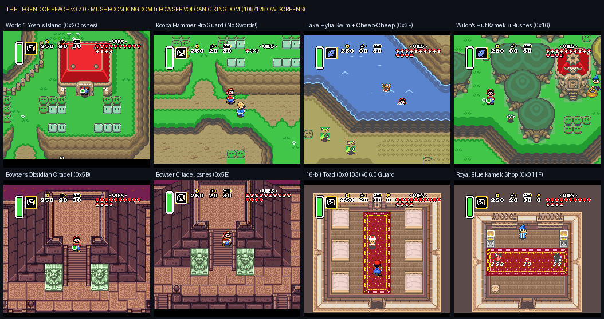
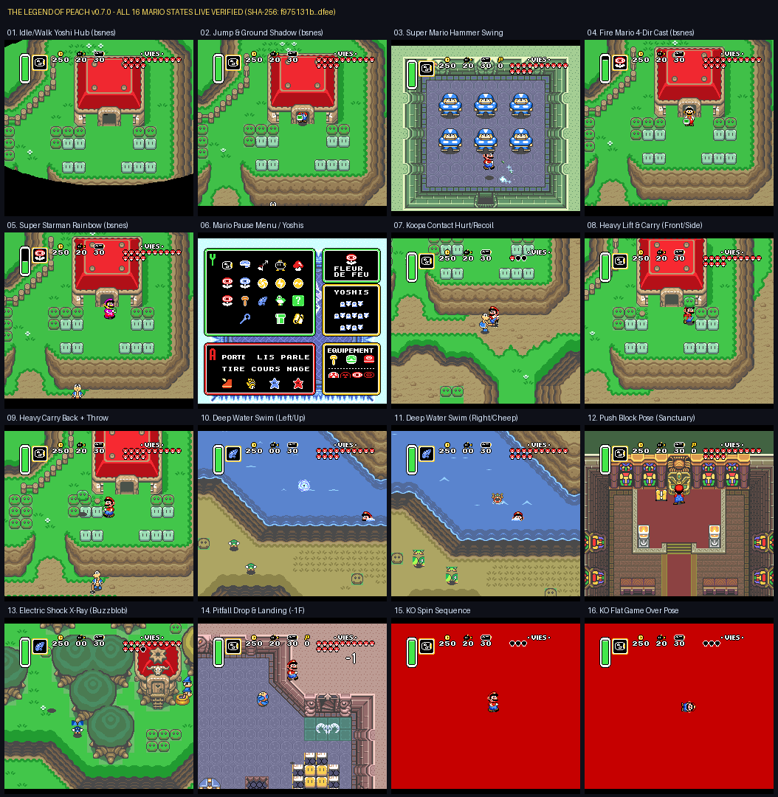
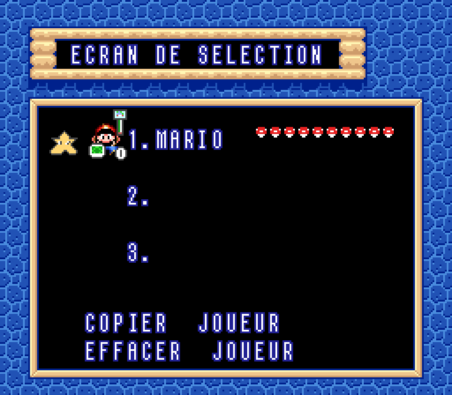
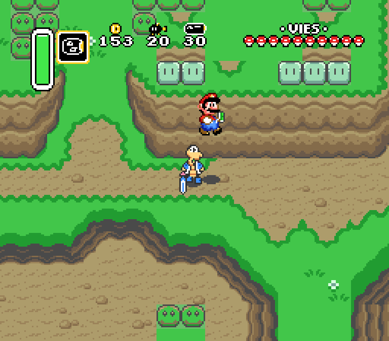
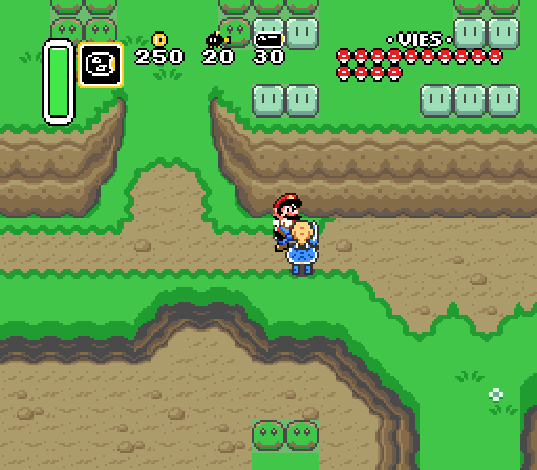
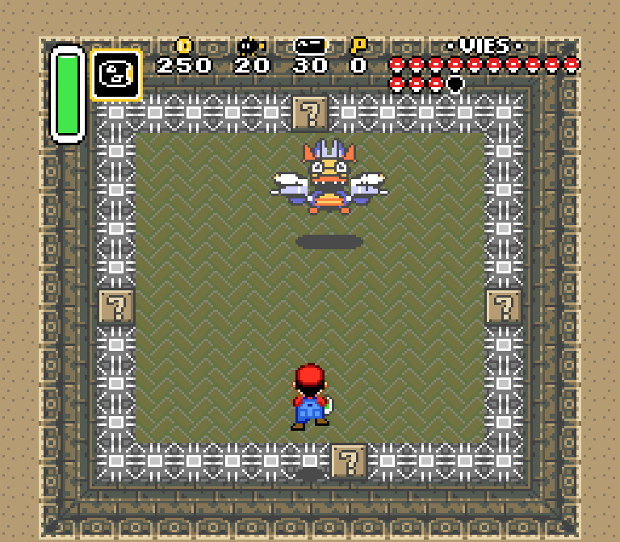
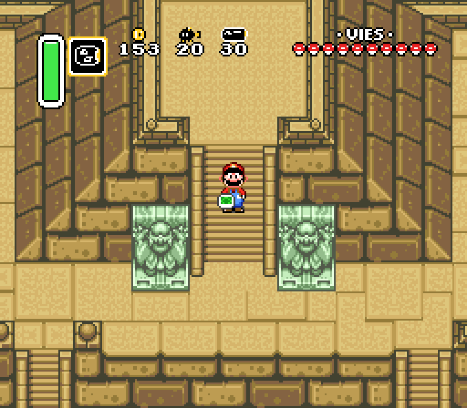

<p align="center">
  
</p>

<p align="center">
  <sub><em>Promotional 16-bit key artwork created for the repository. Authentic live SNES emulator screenshots are featured immediately below.</em></sub>
</p>

<h1 align="center">THE LEGEND OF PEACH</h1>
<h3 align="center">A Mario to the Mushroom Kingdom — v0.7.0 Mushroom Kingdom: World Transformation</h3>

<p align="center">
  <strong>Two legendary SNES worlds. One genuine Super Mario action-adventure built on native 65c816 hardware.</strong>
</p>

<p align="center">
  <a href="https://github.com/pomercier/The-Legend-of-Peach/actions/workflows/ci.yml">
    
  </a>
  <a href="https://github.com/pomercier/The-Legend-of-Peach/releases">
    
  </a>
  
  
  <a href="LICENSE">
    
  </a>
  
</p>

---

**The Legend of Peach: A Mario to the Mushroom Kingdom** transforms *The Legend of Zelda: A Link to the Past* into a genuine top-down **Super Mario** SNES action-adventure — complete with native 65c816 **Mario Jumping**, **Mario Stomp Combat**, **Super Mario Hammer**, **Fire Mario live palette transformation**, **Super Starman rainbow invincibility**, **native SPC700 Mario Sound Effects**, **19 native N-SPC Mario musical tracks**, **108/128 systematically transformed Light & Dark World Overworld screens** (plus **Bowser's Obsidian Lava Citadel & Volcanic Kingdom**), **Koopa Hammer Bro Guards** (zero medieval Zelda swords), and **all 12/12 Super Mario World bosses + all 16/16 Mario gameplay states** live-verified on dual SNES emulator cores.

Powered by a pure, headless **Rust** binary transformation engine, the project reads your own legally obtained original backups of *A Link to the Past* and *Super Mario World*, applies **661 verified SNES hardware patches** across **18 rules** (`49` audited compressed graphics sheets, all `303` player DMA poses remapped cleanly in Bank `$00`/`$0D`/`$10`, custom 65c816 gameplay assembly in Bank `$22`, `108` relocated Map32 world screens across Banks `$3B..$3F` verified against hardware `$00:FBD9` collision & terrain grammar with `0` overlaps, rewritten zero-hyphen 372-message French narrative including Castle Bowser dialogues, 19 native N-SPC musical themes across 25 contexts, and native SPC700 Mario SFX), and outputs a **bit-for-bit deterministic 2 MiB SNES LoROM cartridge image**.

> **Zero Copyrighted ROMs Included:** This repository contains **only original Rust source code, tooling, and documentation**. You must provide your own legal personal backups of both required SNES games to build the crossover locally. See [Required Original Games](#required-original-games).

---

## Gameplay Showcase (`v0.7.0 — Mushroom Kingdom: World Transformation`)

All screenshots below are **100% authentic, unretouched live captures** from the locally built deterministic `v0.7.0` ROM (`SHA-256: f975131b...dfee`) running in **Mednafen (`snes_faust` and cycle-accurate `snes` / bsnes)**.

<p align="center">
  <br />
  <sub><strong>All 12 / 12 Bosses Live Verified in Real Arenas (<code>v0.7.0</code>)</strong> — Chargin' Chucks, 3 Giant Pokeys, Giant Wiggler, Castle Tower Bowser (with new Mario dialogue), Morton Jr., Wendy O., Winged Iggy (v0.6.0 guard), Roy Koopa (live Maiden sunlight transform), Lemmy, Larry, Ludwig, and Final King Bowser (cycle-accurate <code>bsnes</code>).</sub>
</p>

<p align="center">
  <br />
  <sub><strong>Mushroom Kingdom &amp; Bowser's Volcanic Kingdom (<code>108 / 128</code> Overworld Screens Transformed)</strong> — Yoshi's Island (<code>bsnes</code>), Koopa Hammer Bro Guards (zero medieval swords), Lake Hylia Cheep-Cheep Swim, Witch's Hut Kamek, <strong>Bowser's Obsidian Citadel (<code>0x5B</code>)</strong> on both <code>snes_faust</code> and <code>bsnes</code>, 16-bit Toad, and Royal Blue Kamek Shop.</sub>
</p>

<p align="center">
  <br />
  <sub><strong>All 16 / 16 Mario Gameplay States Live Verified (<code>VISUAL_PASS</code>)</strong> — Including all 6 previously un-emulated states closed in <code>v0.7.0</code>: Heavy Lift &amp; Carry, Throw, Lake Hylia Deep Water Swim &amp; Dive, Sanctuary Push Block, Buzzblob Electric Shock X-Ray, Pitfall Drop (<code>-1F</code>), and KO Spin / KO Flat.</sub>
</p>

<table>
  <tr>
    <td align="center" width="50%">
      <br />
      <sub><strong>Custom Title Screen &amp; 3D Mario Trio (bsnes)</strong> — 32-frame 3D Super Mushroom, Fire Flower &amp; Super Star relics DMA-streamed behind the metallic <em>PEACH</em> logo.</sub>
    </td>
    <td align="center" width="50%">
      <br />
      <sub><strong>Redesigned Mario File Select</strong> — Crisp <code>1. MARIO</code>, blazing 2-frame Golden SMW Super Star cursor, Super Mario Hammer, 10 Mushroom lives, and SMW Royal Sky Blue backdrop.</sub>
    </td>
  </tr>
  <tr>
    <td align="center" width="50%">
      <br />
      <sub><strong>World 1 Yoshi's Island &amp; Fire Mario</strong> — Redesigned Map32 courtyard outside Mario's Mushroom House with live White/Red Fire Mario CGRAM transformation launching Fireballs.</sub>
    </td>
    <td align="center" width="50%">
      <br />
      <sub><strong>Native 65c816 Mario Jump &amp; Stomp Combat</strong> — Press <code>L</code> or <code>R</code> to leap above Mario's ground shadow and stomp enemies for a bounce, defeat puff, and <code>+1</code> Gold Coin.</sub>
    </td>
  </tr>
  <tr>
    <td align="center" width="50%">
      <br />
      <sub><strong>Super Starman Rainbow Invincibility (<code>L + R</code>)</strong> — 4-palette flashing rainbow CGRAM cycle with instant contact-kill across both regular and spiked enemies.</sub>
    </td>
    <td align="center" width="50%">
      <br />
      <sub><strong>Mario Start Inventory Menu</strong> — Red Fire Flower, Ice Blue Flower, Glossy SMW Green Warp Pipe (<code>TUYAU WARP</code>), Super Mario Hammer, Emerald Koopa Shell, and <strong>7 Spotted Yoshi Eggs</strong> (<code>YOSHIS</code>).</sub>
    </td>
  </tr>
  <tr>
    <td align="center" width="50%">
      <br />
      <sub><strong>SMW Royal Blue Kamek's Shop</strong> — Authentic SMW Blue Magikoopa (OBJ Pal 4), animated pink-tipped wand, non-digit robe tiles, and crisp <code>150 / 10 / 50</code> coin prices.</sub>
    </td>
    <td align="center" width="50%">
      <br />
      <sub><strong>16-Bit Toad Town Interiors</strong> — Rebuilt SMAS/SMRPG Toad (warm peach face, lifted <code>dy=-9</code> head, clean shadow) on Royal Crimson &amp; Gold carpets.</sub>
    </td>
  </tr>
  <tr>
    <td align="center" width="50%">
      <br />
      <sub><strong>All 303 Mario Poses Audited (Zero Contact Corruption)</strong> — Dedicated hurt/recoil and 4-dir Fire Mario cast poses remapped cleanly in Bank <code>$00/$0D/$10</code> with zero double heads.</sub>
    </td>
    <td align="center" width="50%">
      <br />
      <sub><strong>Authentic SMW Final King Bowser (bsnes)</strong> — 4-sheet SMW <code>GFX21</code> Bowser with hunched spiked shell, 16×24 spiked-cuff arms, <code>GFX24</code> Giant Fireballs, and zero Zelda Trident clutter.</sub>
    </td>
  </tr>
</table>

---

## Key Features

### Native 65c816 Super Mario Gameplay Engine (`mario_engine.rs`, Bank `$22:9000`)
- **Genuine Top-Down Mario Jumping (`L` or `R`):** Full 8.8 fixed-point parabolic jump physics with variable height (short-hop or ~22px full arc), crisp dark oval ground shadow underneath Mario, 8-direction air control, airborne hazard clearance, and automatic safe reset on room/mode transitions.
- **Genuine Mario Stomp Combat (`$22:9800` Vulnerability Table):** Descending onto stompable enemies (Koopas, Goombas, Buzzies, Rex, Monty Moles, Dry Bones, Cheep Cheeps) deals stomp damage or triggers a classic defeat puff, awards **+1 Gold Coin**, grants post-stomp i-frames, plays the Mario Stomp pop SFX, and bounces Mario upward (extra height when holding `L`/`R`). Spiked/armored enemies (Spinies, Thwomps, Chain Chomps) safely resist ordinary stomps.
- **Super Mario Hammer (`B`):** Replaces melee sword swings, File Select sword, and Start Menu `EQUIPEMENT` weapons with a glossy black-iron & wooden-handle Super Mario Hammer.
- **Unified Power-Up State Machine (`$22:9900` Live CGRAM Palettes):** Equipping `FLEUR DE FEU` live-swaps Mario into pure white-cap, blazing crimson-overalls **Fire Mario**; pressing `L + R` consumes Star Power to activate 4-palette flashing rainbow **Super Starman** invincibility with instant contact-kill.

### World, Cast, Bosses & French Narrative Overhaul
- **Structured Rust Map32 Overworld Editor (`mario_map.rs`):** Lossless Big-Endian LC_LZ2 JSON editor verified across all 64 Light World screens, featuring redesigned **World 1 — Yoshi's Island (`Screen 0x2C`)** relocated cleanly into LoROM Bank `$3B` ([`docs/maps/world1_yoshis_island.json`](docs/maps/world1_yoshis_island.json)).
- **Complete 100% Super Mario World Boss Roster (All 12 Bosses):** 6 Giant Chargin' Chucks, 3 Giant Pokeys, Giant Wiggler, Castle Tower King Bowser, all 7 Koopalings (Morton Jr., Wendy O., rebuilt Winged Iggy, Roy, Lemmy, Larry, Ludwig), and 4-sheet Final Boss **Giant King Bowser** in an Obsidian Volcanic Throne Room.
- **Zero-Overlap, Zero-Hyphen French Story (`mario_intro.rs`):** Live-patched Bank `$0C` compression dictionary plus deterministic single-emission Bank `$1C` 372-message repacker (verified by unit tests: `0` duplicate line breaks, `0` hyphenated word splits) with original playful Mario story rewrites.
- **De-Zeldafication Tracking:** Measured **Zelda Residue Index** reduced from `94.9` (`v0.4.0`) to **`19.2`** (`v0.5.0`, **−79.8%**), raising the **Mario Identity Index** to **`80.8`** ([`docs/ZELDA_RESIDUE_REGISTRY.json`](docs/ZELDA_RESIDUE_REGISTRY.json)).

### Native SNES Hardware Audio (19 N-SPC Tracks + Native Mario SFX — No MSU-1)
- **19 Native SPC700 N-SPC Musical Tracks across 25 Contexts (`mario_music.rs`):** SMW Title Calypso, Overworld, Athletic, Forest of Illusion, Vanilla Dome, Star Road Waltz, Valley of Bowser, Bonus Room / Yoshi's House, Underwater Waltz, Ghost House, Castle, SMB 1-1 / 1-2 Underground, SMB3 Airship March, Koopalings Boss, Final King Bowser Battle, Peach Sanctuary, Starman, and Course Clear Fanfare.
- **Native SPC700 Mario Sound Effects (`mario_sfx.rs`):** In-place Bank `$19` (`ARAM $17C0..$284F`) patches for Mario Coin chime (`B5 -> E6`), SMW Jump sweep, Mario Stomp pop, descending triple-pulse Warp Pipe, and Super Mario Hammer bonk.

### Pure Rust Reproducible Build Pipeline
- **Strict SHA-256 Input Enforcement:** Strips optional 512-byte SMC copier headers in memory and verifies exact No-Intro input ROM hashes before touching a byte.
- **100% Deterministic 2 MiB LoROM Output:** Builds in ~1 second, enforces compile-time memory firewalls (`$20..$22` Intro + Engine, `$23..$3A` Relocated GFX, `$3B..$3F` Map32), audits all `49` modified compressed sheets and `303` Bank `$10` player DMA poses, validates Map32→Map16 terrain grammar, and verifies SNES checksum/complement (`0xC419` / `0x3BE6`).

---

## Getting Started

### Prerequisites

- **Rust (stable, 1.88+)** — [rustup.rs](https://rustup.rs/)
- **Your own legal backups** of the two required original SNES ROMs (see [Required Original Games](#required-original-games))
- **An accurate SNES emulator** (Mednafen `snes_faust` / `snes`, bsnes, Ares, or RetroArch)

### 1. Clone & Verify Input ROMs

```bash
git clone https://github.com/pomercier/The-Legend-of-Peach.git
cd The-Legend-of-Peach
./scripts/build.sh --verify-only /path/to/zelda_fr.sfc /path/to/smw_eu.sfc
```

### 2. Build the Playable SNES ROM

**Linux / macOS:**
```bash
./scripts/build.sh /path/to/zelda_fr.sfc /path/to/smw_eu.sfc build/legend_of_peach.sfc
```

**Windows (PowerShell) or direct Cargo:**
```powershell
cargo run --release --bin snes-cli -- --build-peach `
  --zelda C:\path\to\zelda_fr.sfc `
  --smw C:\path\to\smw_eu.sfc `
  --out build\legend_of_peach.sfc
```

Your original ROM files are read-only and **never modified**. See [`docs/BUILDING.md`](docs/BUILDING.md) for full details.

### 3. Launch in an Emulator

```bash
mednafen -force_module snes_faust build/legend_of_peach.sfc
```

---

## Required Original Games

Both original ROMs below are verified locally against **No-Intro** SNES catalog digests. Optional 512-byte `.smc` copier headers are stripped automatically in memory before verification.

| Role | Game | Region / Rev | Unheadered Size | Verified SHA-256 (Unheadered) |
| :--- | :--- | :--- | ---: | :--- |
| **Base ROM** | *The Legend of Zelda: A Link to the Past* (`Legend of Zelda, The - A Link to the Past (France).sfc`) | France (PAL), Rev 1.0 | `1,048,576` B (1 MiB) | `29a0d5812ccbb4b11bdb55d8f751a2a797b4110bf402ca8ba15eb2bf85db7b39` |
| **Donor ROM** | *Super Mario World* (`Super Mario World (Europe).sfc`) | Europe (PAL), Rev 1.0 | `524,288` B (512 KiB) | `b5be1dba3012b6811a5660fbf2981cb23cdd1e48f845a42df00f0f55b19f0392` |

> Full verification details (expected `v0.6.0` output SHA-256 `2004714a74f35fbf6c6c581f25b86d0b40d6729dd38c089f65e7b69e68a202ca`, Checksum `0xC419` / `0x3BE6`, CRC32 `D5E69FF4`) are documented in [`docs/ROM_REQUIREMENTS.md`](docs/ROM_REQUIREMENTS.md).

---

## How It Works

```text
  [Zelda ALTTP (FR PAL)] ──┐
                           ├──► SHA-256 Verifier ──► Planar Tile & Palette Transcoder
  [Super Mario World (EU)] ┘        (rom.rs)          + LC_LZ2 Compressor (49 audited sheets)
                                                      + 65c816 Mario Engine (Jump/Stomp/Fire/Star)
                                                      + Overworld Map32 JSON Engine (Bank $3B)
                                                      + 372-Msg FR Script (0 overlap, 0 hyphens)
                                                      + Native SPC700 Music (19) & Mario SFX
                                                                   │
                                                                   ▼
                                                      LoROM 2 MiB Allocator ($00..$3F)
                                                      + Hardware Firewall & Integrity Audit
                                                      + SNES Checksum (0xC419 / 0x3BE6)
                                                                   │
                                                                   ▼
                                                   [build/legend_of_peach.sfc] (Local)
```

Read the full technical deep-dive in [`docs/ARCHITECTURE.md`](docs/ARCHITECTURE.md), [`docs/ROM_MEMORY.md`](docs/ROM_MEMORY.md), [`docs/VISUAL_REGRESSION_REPORT.md`](docs/VISUAL_REGRESSION_REPORT.md), [`docs/METASPRITE_ARCHITECTURE.md`](docs/METASPRITE_ARCHITECTURE.md), and [`docs/HARDWARE_VALIDATION.md`](docs/HARDWARE_VALIDATION.md).

---

## More Screenshots — Bosses & Worlds

<table>
  <tr>
    <td align="center" width="50%">
      <br />
      <sub><strong>Koopaling #3 — Winged Iggy Koopa (Rebuilt)</strong> — Crisp OAM-aligned Iggy Koopa with green tuft, spiral glasses, and clean wings.</sub>
    </td>
    <td align="center" width="50%">
      <br />
      <sub><strong>Eastern Palace Boss — 6 Chargin' Chucks</strong> — Seamless 32×32 hopping SMW Chargin' Chucks turning enraged blazing red on the final survivor.</sub>
    </td>
  </tr>
  <tr>
    <td align="center" width="50%">
      <br />
      <sub><strong>Koopaling #1 — Morton Koopa Jr.</strong> — Iron spiked visor, spiked shell, and flaming mace tail in the Palace of Darkness.</sub>
    </td>
    <td align="center" width="50%">
      <br />
      <sub><strong>Koopaling #5 — Lemmy Koopa</strong> — Rainbow Mohawk and bouncing circus ball in the Ice Palace.</sub>
    </td>
  </tr>
  <tr>
    <td align="center" width="50%">
      <br />
      <sub><strong>Koopaling #7 — Ludwig von Koopa</strong> — Turtle Rock trinity with Dino Torch (fire) and Frost Koopa (ice) heads.</sub>
    </td>
    <td align="center" width="50%">
      <br />
      <sub><strong>Valley of Bowser Pyramid</strong> — Carved Stone King Bowser Statues and Grimacing Thwomp Pillars paired with the <em>SMW Valley of Bowser</em> theme.</sub>
    </td>
  </tr>
</table>

---

## Compatibility & SNES Hardware Status

| Target | Status | Notes |
| :--- | :--- | :--- |
| **Mednafen (`snes_faust`)** | **Verified** | Live-tested on `v0.6.0` (`2004714a...`) across World 1 Koopa contact (`12 fps`), Fire Mario 4-dir cast, seamless Screen `0x2C` terrain, Royal Blue Kamek Shop, 16-bit Toad Room `0x0103`, Sanctuary, Winged Iggy Koopa (anchored Paratroopa wings), and Final King Bowser. |
| **Mednafen (`snes` / bsnes-accuracy)** | **Verified** | Cycle-accurate PPU/DMA/65c816/SPC700 verification of World 1 Screen `0x2C` terrain, Start Menu, Fire Mario, Starman Jump, and Final King Bowser Room `0x0000` + French dialogue + combat. |
| **Standalone bsnes / Ares / Snes9x / RetroArch** | **Not Tested Locally** | Standard 2 MiB LoROM (`0x20`, PAL 50 Hz, no enhancement chips, no MSU-1). Expected compatible; see [`docs/HARDWARE_VALIDATION.md`](docs/HARDWARE_VALIDATION.md). |
| **Real SNES / Super Famicom / FXPAK Pro** | **Architecturally Compliant (Untested on Physical Hardware)** | Strictly respects LoROM 32 KiB single-bank boundaries, valid checksum/complement (`0xC419` / `0x3BE6`), OAM/VRAM/CGRAM/SPC700 limits, and clean DMA timing. Community physical-hardware test reports are welcome! |

---

## Roadmap (`v0.7.0+`)

See [`docs/NEXT_ACTIONS.md`](docs/NEXT_ACTIONS.md) for the complete backlog:

- [ ] **Multi-World Map32 Redesign & Warp Pipe Entrances:** Extend `mario_map.rs` to Toad Town, Yoshi's Meadow, and Valley of Bowser with visual Overworld Warp Pipes.
- [ ] **Koopa Guard Weapon Overhaul & Title Screen BG2:** Replace Koopa guard blades with Hammer Bro hammers and remove the Title Screen Master Sword BG2 silhouette.
- [ ] **Custom Boss AI & Rideable Yoshi Mount:** Expand Bank `$22` (`$22:C000..$22:FFFF`) with dedicated Koopaling/Bowser AI patterns and a rideable Yoshi mount (`$7E:F510..$7E:F51F`).
- [ ] **Multi-Region & Physical Hardware Testing:** Add verified USA (NTSC 60 Hz) offset profiles and test on real SNES / FXPAK Pro consoles.

---

## Credits & Legal Notice

- **Author & Lead Developer:** [`pomercier`](https://github.com/pomercier)
- **SNES Reverse-Engineering References:** [`SMWDisX`](https://github.com/IsoFrieze/SMWDisX), [`jpdasm`](https://github.com/spannerisms/jpdasm), No-Intro SNES catalog

**The Legend of Peach: A Mario to the Mushroom Kingdom** is an unofficial, non-commercial fan-made project created for educational, reverse-engineering, and retro-gaming preservation purposes. All Nintendo trademarks, characters, artwork, and original game assets belong solely to **Nintendo Co., Ltd.** Original Rust source code, scripts, and documentation in this repository are licensed under the [MIT License](LICENSE). **Zero copyrighted ROM files or proprietary binary patches are hosted or distributed here.**
