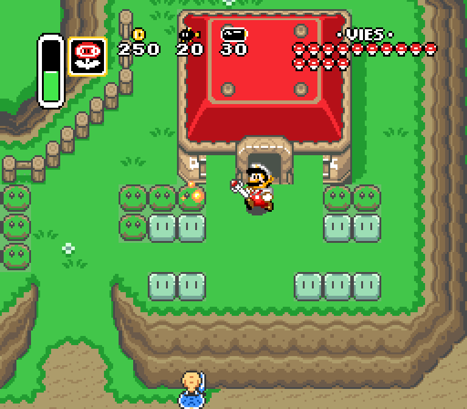
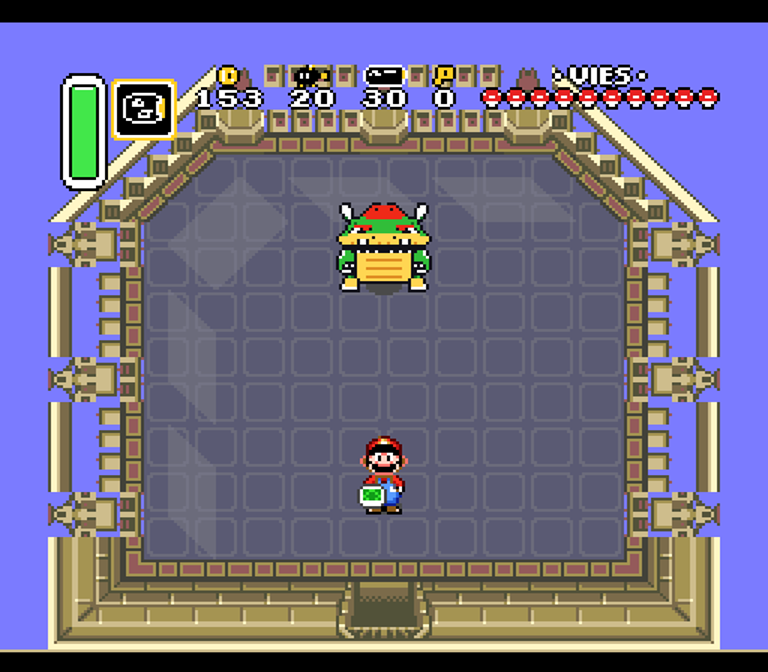
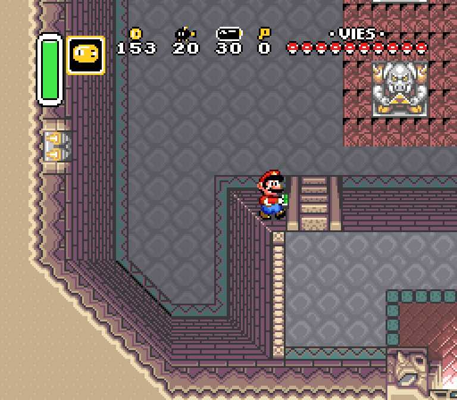
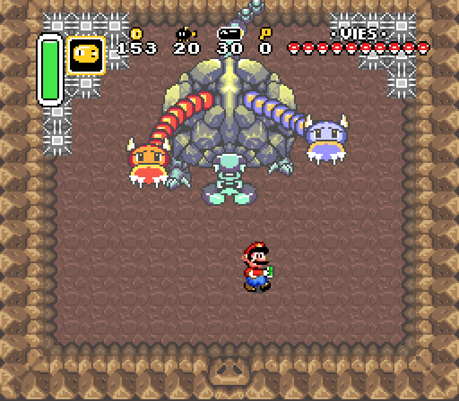
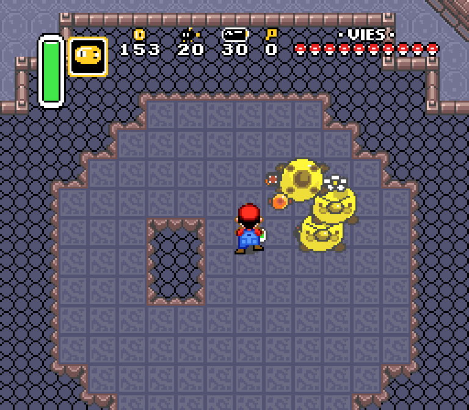

<p align="center">
  
</p>

<p align="center">
  <sub><em>Promotional 16-bit key artwork created for the repository. Authentic live SNES emulator screenshots are featured immediately below.</em></sub>
</p>

<h1 align="center">THE LEGEND OF PEACH</h1>
<h3 align="center">A Mario to the Mushroom Kingdom</h3>

<p align="center">
  <strong>Two legendary SNES worlds. One unforgettable adventure.</strong>
</p>

<p align="center">
  <a href="https://github.com/pomercier/The-Legend-of-Peach/actions/workflows/ci.yml">
    
  </a>
  <a href="https://github.com/pomercier/The-Legend-of-Peach/releases">
    
  </a>
  
  
  <a href="LICENSE">
    
  </a>
  
</p>

---

**The Legend of Peach: A Mario to the Mushroom Kingdom** is a fan-made Super Nintendo (SNES) total-conversion crossover that transforms *The Legend of Zelda: A Link to the Past* into a sprawling 16-bit *Super Mario World* action-adventure.

Powered by a pure, headless **Rust** binary transformation engine, the project reads your own legally obtained original backups of *A Link to the Past* and *Super Mario World*, applies **182 verified SNES hardware patches** across graphics, 65c816 assembly, palettes, world tilesets, all 12 bosses, live French dialogue & compression dictionaries, and **13 native SPC700 N-SPC music tracks**, and outputs a **bit-for-bit deterministic 2 MiB SNES LoROM cartridge image**.

> **Zero Copyrighted ROMs Included:** This repository contains **only original Rust source code, tooling, and documentation**. You must provide your own legal personal backups of both required SNES games to build the crossover locally. See [Required Original Games](#required-original-games).

---

## Gameplay Showcase

All screenshots below are **authentic, unretouched captures** from the locally built `v0.3.0` ROM running live in **Mednafen (`snes_faust` and cycle-accurate `bsnes`)**, integer-scaled `3×` nearest-neighbor (`768×672`) directly from native `256×224` SNES video output.

<table>
  <tr>
    <td align="center" width="50%">
      <br />
      <sub><strong>Custom Title Screen &amp; 3D Intro (bsnes)</strong> — 32-frame 3D Mushroom, Fire Flower &amp; Super Star relics DMA-streamed behind the metallic <em>PEACH</em> logo.</sub>
    </td>
    <td align="center" width="50%">
      <br />
      <sub><strong>Mushroom Kingdom Overworld</strong> — Mario outside his red polka-dot Mushroom Roof house with SMW smiling bushes, Turn-Blocks, patrolling Koopa, and sleek Bullet Bill HUD.</sub>
    </td>
  </tr>
  <tr>
    <td align="center" width="50%">
      <br />
      <sub><strong>Mario Start Inventory Menu</strong> — Jet-Black Bullet Bill &amp; Bob-ombs, Fire Flower, SMW Hammer, <strong>7 Spotted SMW Yoshi Eggs</strong> (<code>YOSHIS</code>), and Emerald Green Koopa Shell shield.</sub>
    </td>
    <td align="center" width="50%">
      <br />
      <sub><strong>Kamek's Toad Town Shop</strong> — Magikoopa shopkeeper with crisp <code>150 / 10 / 50</code> coin prices, Super Mushroom, and 10-pack Jet-Black SMW Bob-ombs.</sub>
    </td>
  </tr>
  <tr>
    <td align="center" width="50%">
      <br />
      <sub><strong>Eastern Palace Boss — 6 Chargin' Chucks</strong> — Seamless 32×32 hopping SMW Chargin' Chucks replacing Armos Knights (enraged blazing red on the final survivor!).</sub>
    </td>
    <td align="center" width="50%">
      <br />
      <sub><strong>Final Showdown — Giant King Bowser (bsnes)</strong> — Multi-sheet King Bowser with emerald spiked shell, crimson mane, exclusive BGR555 palettes, and dedicated Final Bowser N-SPC theme.</sub>
    </td>
  </tr>
</table>

---

## Key Features

### World, Characters & Visual Overhaul
- **Custom 3D Intro & Title Sequence:** 32 pre-rendered 4bpp frames of rotating 3D Super Mushroom, Fire Flower, and Super Star relics streamed via custom 65c816 VBlank DMA routines in LoROM banks `$20..$22`, paired with the giant **`THE LEGEND OF PEACH: A MARIO TO THE MUSHROOM KINGDOM`** title logo and rewritten story crawl.
- **Playable Hero & Mushroom Kingdom Cast:**
  - Full playable **Mario** animation set (walk, sword slash, Emerald Green Koopa Shell shield, spin attack, and overhead block/bush carry with fixed OAM carry-height offset).
  - **Princess Peach**, **Uncle Luigi** (rebuilt from Mario's proportions in green with clean OAM head/body alignment), **Toad**, **Yoshi**, and **Kamek (Magikoopa)** shopkeeper.
- **Cohesive Mario HUD & Start Inventory:** Jet-Black & White **SMW Bullet Bill** (`BILL BLASTER`), **Jet-Black SMW Bob-ombs** across HUD, ground drops, chests, and shops (zero blue bombs anywhere!), Gold Coins, Super Mushroom life containers, **`YOSHIS` 7 Spotted SMW Yoshi Eggs**, Emerald Green Koopa Shell shield, and Mushroom / Fire Flower / Super Star quest relics.
- **16-Sheet SMW Bestiary & 9 Worldwide Tilesets:** Koopa Troopas (with corrected weapon grip offsets), Goombas, Spinies, Rex, Spike Tops, Piranha Plants, Boos, Dry Bones, Thwomps, Cheep Cheeps, Mario's red polka-dot Mushroom Roof house (`bg:4D`), SMW smiling bushes, Turn-Blocks, Question Blocks, SMW Castle Brick walls (`bg:0D`), and carved Stone King Bowser Statues (`bg:18/19`).
- **Full French Script & Compression Dictionary Conversion:** Live-patched Bank `$0C` French compression dictionary (`Ganon` → `Bowser`, `rubis` → `pièces`, `Sahasrahla` → `Papy Toad`, `Perle de Lune` → `Lune 3-UP`) plus Bank `$1C` script rewriting (`Zelda` → `Peach`, `Agahnim` → `Bowser`, `Hyrule` → `Champi`, `Cocorico` → `ToadTown`, `Excalibur` → `Épée Star`, `Sages` → `Toads`, `jeunes filles` → `jeunes Yoshi`).

### Complete 100% Super Mario World Boss Roster (All 12 Bosses!)
- **Eastern Palace:** **6 Giant 32×32 Hopping SMW Chargin' Chucks** (blue football gear turning enraged red on the final survivor).
- **Desert Palace & Tower of Hera:** **3 Giant Pokeys** and **Giant Wiggler**.
- **Castle Tower:** **King Bowser** (symmetric 32×32 front, back, and upgraded golden-snout side profile with zero leftover vanilla Agahnim tiles).
- **All 7 Koopalings:** Morton Koopa Jr. (iron spiked visor & flaming mace tail), Wendy O. Koopa (candy rings), Winged Iggy Koopa, Roy Koopa (pink shades), Lemmy Koopa (rainbow Mohawk & circus ball), Larry Koopa (+12 Mini-Spinies), and Ludwig von Koopa (+Dino Torch & Frost Koopa).
- **Final Boss:** **Giant King Bowser** built across 4 dedicated sprite sheets and 2 exclusive BGR555 palettes.

### Native SNES Hardware Audio (13 N-SPC Tracks — No MSU-1 Required)
- **13 Native SPC700 N-SPC Tracks:** Super Mario melodies compiled directly into *A Link to the Past*'s native `$D000` N-SPC audio engine — including Title/Intro (SMB 1-1), Light World Overworld (SMW Overworld), Toad Town & Lost Woods (SMW Athletic), Dark World Overworld (**SMW Valley of Bowser**), Kamek/Toad Shops (**SMW Bonus Room / Yoshi's House**), Haunted Dungeons (SMW Ghost House), Castles (SMW Castle), Underground Caves (SMB 1-2), Koopalings Bosses (SMW Koopalings), Final Showdown (**SMW Final King Bowser Battle**), Sanctuary (SMW Peach), Starman Action, and Course Clear Fanfare.

### Pure Rust Reproducible Build Pipeline
- **Strict SHA-256 Input Enforcement:** Automatically strips optional 512-byte SMC copier headers in memory and verifies exact No-Intro input ROM hashes before touching a byte.
- **100% Deterministic 2 MiB LoROM Output:** Compiles and builds in under 1 second, automatically audits bank alignment, zero patch overlaps, LC_LZ2 decompression round-trips across all 46 modified sheets, and valid SNES header checksum/complement (`0xEE72` / `0x118D`).

---

## The Adventure

Storm clouds gather over the Mushroom Kingdom. **Princess Peach** calls out telepathically from the castle dungeon, where **Bowser** and his seven **Koopalings** have seized control of the royal strongholds and twisted the realm into a dark shadow of itself.

Waking in his mushroom-roofed home alongside **Uncle Luigi**, **Mario** takes up blade, Emerald Green Koopa Shell shield, Bill Blaster, and Jet-Black Bob-ombs — venturing across smiling overworld hills, Toad Town's Magikoopa shop, Eastern Palace's squad of Chargin' Chucks, haunted castles, Bowser-guarded temples, and the Dark World Mushroom Pyramid to rescue the 7 Yoshis and confront **Giant King Bowser** in the final chamber.

---

## Getting Started

### Prerequisites

- **Rust (stable, 1.88+)** — [rustup.rs](https://rustup.rs/)
- **Your own legal backups** of the two required original SNES ROMs (see [Required Original Games](#required-original-games))
- **An accurate SNES emulator** (Mednafen `snes_faust` / `snes`, bsnes, Ares, or RetroArch)

### 1. Clone the Repository

```bash
git clone https://github.com/pomercier/The-Legend-of-Peach.git
cd The-Legend-of-Peach
```

### 2. Verify Your Input ROMs

```bash
./scripts/build.sh --verify-only /path/to/zelda_fr.sfc /path/to/smw_eu.sfc
```

### 3. Build the Playable SNES ROM

**Linux / macOS:**
```bash
./scripts/build.sh /path/to/zelda_fr.sfc /path/to/smw_eu.sfc build/legend_of_peach.sfc
```

**Windows (PowerShell) or direct Cargo:**
```powershell
cargo run --release --bin snes-cli -- --build-peach `
  --zelda C:\path\to\zelda_fr.sfc `
  --smw C:\path\to\smw_eu.sfc `
  --out build\legend_of_peach.sfc
```

Your original ROM files are read-only and **never modified**. For full step-by-step instructions, see [`docs/BUILDING.md`](docs/BUILDING.md).

### 4. Launch in an Emulator

```bash
mednafen -force_module snes_faust build/legend_of_peach.sfc
```

---

## Required Original Games

Both original ROMs below are verified locally against **No-Intro** SNES catalog digests. Optional 512-byte `.smc` copier headers are stripped automatically in memory before verification.

| Role | Game | Region / Rev | Unheadered Size | Verified SHA-256 (Unheadered) |
| :--- | :--- | :--- | ---: | :--- |
| **Base ROM** | *The Legend of Zelda: A Link to the Past* (`Legend of Zelda, The - A Link to the Past (France).sfc`) | France (PAL), Rev 1.0 | `1,048,576` B (1 MiB) | `29a0d5812ccbb4b11bdb55d8f751a2a797b4110bf402ca8ba15eb2bf85db7b39` |
| **Donor ROM** | *Super Mario World* (`Super Mario World (Europe).sfc`) | Europe (PAL), Rev 1.0 | `524,288` B (512 KiB) | `b5be1dba3012b6811a5660fbf2981cb23cdd1e48f845a42df00f0f55b19f0392` |

> Full verification details (SHA-1, CRC32, OS checksum commands, expected `v0.3.0` output SHA-256 `fe7390a1c4e58e219d8e6f023cc4f09ce6e7e6d5164bf1bb30b2dbf1c2828785`, and why exact revisions are strictly enforced) are documented in [`docs/ROM_REQUIREMENTS.md`](docs/ROM_REQUIREMENTS.md).

---

## How It Works

```text
  [Zelda ALTTP (FR PAL)] ──┐
                           ├──► SHA-256 Verifier ──► Planar Tile & Palette Transcoder
  [Super Mario World (EU)] ┘        (rom.rs)          + LC_LZ2 Compressor (46 sheets)
                                                      + 65c816 3D Intro & OAM Patches
                                                      + Live FR Dictionary & Script Engine
                                                      + Native SPC700 N-SPC Compiler (13 tracks)
                                                                   │
                                                                   ▼
                                                      LoROM 2 MiB Allocator ($00..$3F)
                                                      + Hardware Integrity Audit
                                                      + SNES Checksum (0xEE72 / 0x118D)
                                                                   │
                                                                   ▼
                                                   [build/legend_of_peach.sfc] (Local)
```

Read the full technical deep-dive — including the 2 MiB LoROM bank map, reserved `$20..$22` 3D DMA intro buffers, Bank `$0C` live dictionary architecture, and post-build audit checks — in [`docs/ARCHITECTURE.md`](docs/ARCHITECTURE.md).

---

## More Screenshots — Castles, Dungeons & Bosses

<table>
  <tr>
    <td align="center" width="50%">
      <br />
      <sub><strong>Castle Tower Boss — King Bowser</strong> — Upgraded front and golden-snout side profile casting energy spheres across the royal tower.</sub>
    </td>
    <td align="center" width="50%">
      <br />
      <sub><strong>Bowser's Castle Architecture</strong> — Dungeon brick walls and carved Stone King Bowser Statues replacing Hyrule stonework.</sub>
    </td>
  </tr>
  <tr>
    <td align="center" width="50%">
      <br />
      <sub><strong>Dark World Mushroom Pyramid</strong> — Descending between carved emerald Stone Bowser Statues to the new <em>SMW Valley of Bowser</em> N-SPC theme.</sub>
    </td>
    <td align="center" width="50%">
      <br />
      <sub><strong>Koopaling #1 — Morton Koopa Jr.</strong> — Iron spiked visor, spiked shell, and flaming mace tail in the Palace of Darkness.</sub>
    </td>
  </tr>
  <tr>
    <td align="center" width="50%">
      <br />
      <sub><strong>Koopaling #5 — Lemmy Koopa</strong> — Rainbow Mohawk and bouncing circus ball encased in the Ice Palace crystal chamber.</sub>
    </td>
    <td align="center" width="50%">
      <br />
      <sub><strong>Koopaling #7 — Ludwig von Koopa</strong> — Turtle Rock trinity with Dino Torch (fire) and Frost Koopa (ice) heads.</sub>
    </td>
  </tr>
  <tr>
    <td align="center" width="50%">
      <br />
      <sub><strong>Tower of Hera — Giant Wiggler</strong> — Multi-segmented SMW Wiggler charging across the tower summit.</sub>
    </td>
    <td align="center" width="50%">
      <sub><strong>All 12 Bosses Transformed:</strong> Eastern Palace (6 Chargin' Chucks), Desert Palace (3 Giant Pokeys), Tower of Hera (Giant Wiggler), Castle Tower (King Bowser), Palace of Darkness (Morton Jr.), Swamp Palace (Wendy), Skull Woods (Iggy), Thieves' Town (Roy), Ice Palace (Lemmy), Misery Mire (Larry), Turtle Rock (Ludwig), and Pyramid Final Boss (Giant King Bowser).</sub>
    </td>
  </tr>
</table>

---

## Compatibility & SNES Hardware Status

| Target | Status | Notes |
| :--- | :--- | :--- |
| **Mednafen (`snes_faust`)** | **Verified** | Live-tested across title screen, Start menu, overworld, Kamek's Shop, Dark World, castles, Eastern Palace Chargin' Chucks, Castle Tower Bowser, all 7 Koopalings, Pokeys, Wiggler, and Giant King Bowser (with verified stereo SPC700 audio RMS). |
| **Mednafen (`snes` / bsnes-accuracy)** | **Verified** | Cycle-accurate PPU/DMA/SPC700 verification of the 3D intro, title logo, Final Boss Giant King Bowser combat, dialogue, and Final Bowser N-SPC soundtrack. |
| **bsnes / Ares / RetroArch (`bsnes`, `snes9x`)** | **Expected Compatible** | Standard 2 MiB LoROM (`0x20`, PAL 50 Hz, no enhancement chips, no MSU-1). |
| **Real SNES / Super Famicom / FXPAK Pro** | **Architecturally Compliant (Untested on Physical Hardware)** | Strictly respects LoROM 32 KiB single-bank boundaries, valid checksum/complement (`0x2EC1` / `0xD13E`), OAM/VRAM/CGRAM/SPC700 limits, and clean DMA timing. Community physical-hardware test reports are very welcome! |

---

## Roadmap

Items below are **planned future milestones** (not yet implemented in `v0.3.0`):

- [ ] **Multi-Region Support:** Add verified offset tables for *The Legend of Zelda: A Link to the Past (USA)* (NTSC 60 Hz, English dialogue) and *Super Mario World (USA)*.
- [ ] **Overworld World Map & Title Landscape:** Replace remaining overworld world-map graphics and Title Screen background mountains with Yoshi's Island hills.
- [ ] **Physical Hardware Verification:** Test and document behavior on original SNES/Super Famicom consoles via FXPAK Pro / SD2SNES.
- [ ] **Ending & File Select Audio:** Expand native SPC700 arrangements for remaining resident fanfare slots.

---

## Credits & References

- **Author & Lead Developer:** [`pomercier`](https://github.com/pomercier)
- **SNES Reverse-Engineering References:**
  - [`SMWDisX`](https://github.com/IsoFrieze/SMWDisX) by IsoFrieze — *Super Mario World* disassembly reference
  - [`jpdasm`](https://github.com/spannerisms/jpdasm) by spannerisms — *The Legend of Zelda: A Link to the Past* disassembly reference
- **ROM Verification Standards:** No-Intro SNES preservation catalog

---

## Legal Notice

**The Legend of Peach: A Mario to the Mushroom Kingdom** is an unofficial, non-commercial fan-made project created for educational, reverse-engineering, and retro-gaming preservation purposes.

*The Legend of Zelda: A Link to the Past*, *Super Mario World*, *Super Nintendo Entertainment System (SNES)*, Mario, Luigi, Princess Peach, Bowser, the Koopalings, and all related trademarks, characters, artwork, and original game assets are the sole property of **Nintendo Co., Ltd.** This project is **not** affiliated with, endorsed by, or sponsored by Nintendo.

- Original Rust source code, scripts, and documentation in this repository are licensed under the [MIT License](LICENSE).
- **No copyrighted ROM files or binary ROM patches containing Nintendo assets are hosted or distributed here.** Users must build locally from their own legally obtained backups.

---

## Support & Contributions

- Hit a build or emulator issue? Check [`docs/TROUBLESHOOTING.md`](docs/TROUBLESHOOTING.md) or open a [Bug Report](.github/ISSUE_TEMPLATE/bug_report.md).
- Want to contribute code, multi-region offset maps, or hardware tests? Read [`CONTRIBUTING.md`](CONTRIBUTING.md).
- Release history is tracked in [`CHANGELOG.md`](CHANGELOG.md), and security/integrity practices in [`SECURITY.md`](SECURITY.md).
